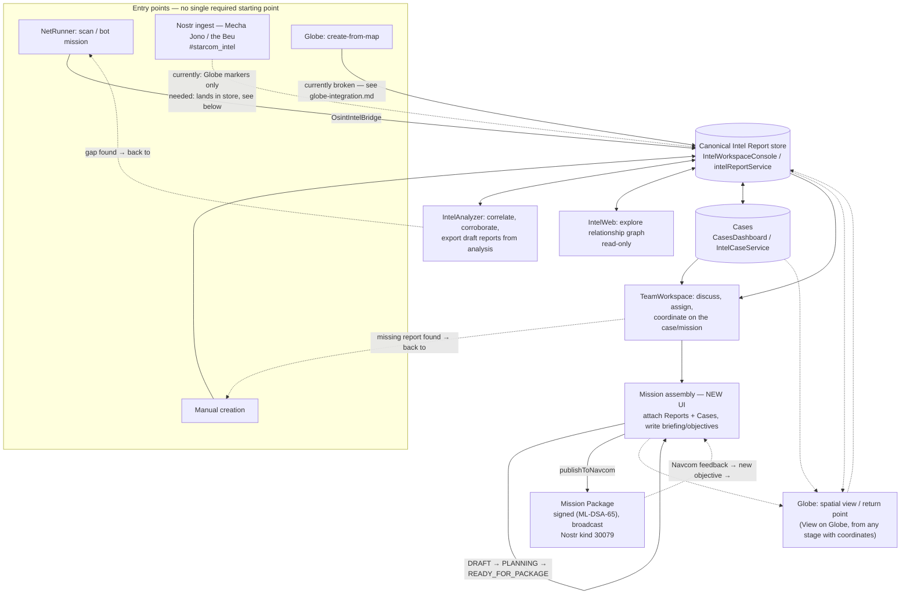

# The Target Pipeline

Answering directly: **it is not a straight line, and it shouldn't be.** It's
a graph with one genuinely linear spine (Report → **Case** → **Mission** →
Package → Publish) and several legitimate entry points and loop-backs around
it.

> **Corrected.** This spine used to read "Report → Case/Mission attachment",
> treating Case and Mission as *parallel* things a report could be attached to.
> They are not: a Mission is **downstream of** a Case — the Case is the
> investigation, the Mission is the deliverable produced from it. See
> [`../01-architecture-decisions/mission-downstream-of-case.md`](../01-architecture-decisions/mission-downstream-of-case.md).
> Nothing *enforces* a Case before a Mission, and that is deliberate; this
> describes the path, not a gate. Forcing it into a single line would be false to how intelligence work
actually happens — an analyst correlating existing reports and a NetRunner
operator scanning a new domain are both "starting," at different points in
the same graph, and either one might send you back to an earlier stage
(analysis reveals a gap → back to NetRunner; team discussion on a mission
reveals a missing report → back to report creation).

## The graph

## The loops, named explicitly (the user asked directly whether these exist — yes)

1. **Analysis → back to collection.** Correlating reports in IntelAnalyzer surfaces a gap (a claim with only one source, a location with no coverage) — the natural next step is back to NetRunner or manual creation to fill it, not forward to packaging. Nothing in the UI currently suggests this loop exists; it should (e.g. a "gaps" panel in AnalysisWorkbench linking out to NetRunner with the gap pre-filled as a search target — future work, not Sprint 1).
2. **Team coordination → back to reports.** Discussing a mission with the team surfaces something missing — the mission-assembly screen should let you jump back to report creation without losing your place, not force a full restart.
3. **Publish → new mission.** A dispatched Mission Package generates real-world follow-up (an objective completed, a new lead) — that's a new mission, not a dead end. The state machine already supports this (missions aren't singletons; nothing stops creating a new one), it just isn't surfaced anywhere as "here's what came out of this."
4. **Globe is a loop-back point from everywhere, not a stage.** Any record with coordinates (Report, Case, eventually Mission) should support "View on Globe," and the Globe should support "Create from here" back into the store — a return/anchor point threaded through the whole graph, per the `globe-role.md` decision, not a gate any of these loops has to pass through.

## What's overloaded vs. underloaded today (the user asked this directly too)

- **Overloaded**: NetRunner's `BotCard` — one "Run" button silently does scan + report creation + optional Nostr broadcast, with no confirmation step and no way to review before it's persisted. Three separate concerns collapsed into one silent action.
- **Underloaded**: Mission assembly — the entire back half of the pipeline (attach reports/cases, write briefing/objectives, move through the state machine, publish) has *no UI at all*. This is the single most underloaded stage in the whole graph, and it's Sprint 1's target.
- **Underloaded**: Team coordination on a shared deliverable — the data model (`collaborators`/`comments`/`activityLog` on `MissionUI`) is real; there's no view. See `team-coordination.md`.
- **Overloaded, differently**: the "browse/create Intel Reports" job has three separate screens doing the same underloaded amount of work each, instead of one screen doing it well — see `canonical-intel-report-path.md`.

## See also

- [`user-stories.md`](user-stories.md) — the same graph, walked through by persona.
- [`../01-architecture-decisions/globe-role.md`](../01-architecture-decisions/globe-role.md) — why the Globe is drawn as a loop-back anchor, not a pipeline stage.
