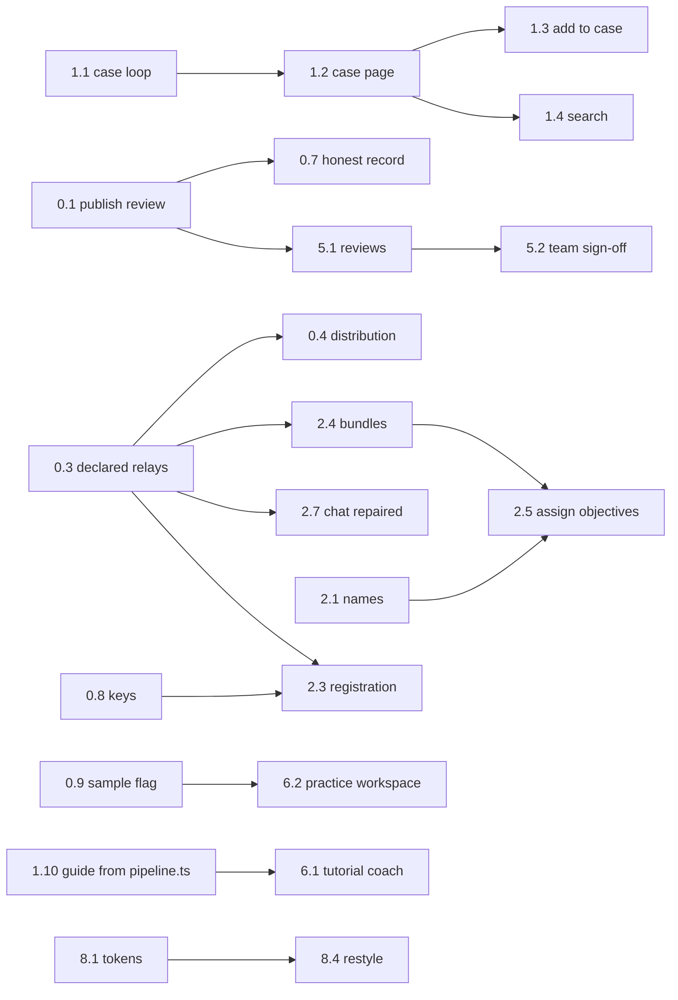

# Intern readiness: build plan

Written 2026-09-25 from the audit in [`intern-readiness.md`](intern-readiness.md),
and reworked 2026-09-26 after the decisions in
[`intern-readiness-decisions.md`](intern-readiness-decisions.md). Each work item
names the story it closes, the files it touches, the test to write first, its
size, and what could make it grow.

**The premise, as decided.**
- The interns are Starcom Academy's fourth cohort: twelve weeks from
  **2026-12-01**. They use the **live app** as testers, as open agents who form
  their own teams.
- There is no training site.
- Work is shared as signed bundles over the internal relays.
- Publishing needs no approval. An optional team sign-off and reviews after
  publishing are wanted.

**This file carries no status.** An item is done when the story it closes is
walked again and passes. The statuses live in
[`../03-pipeline/user-stories.md`](../03-pipeline/user-stories.md), and item V1
turns that walk into a script.

Sizes are for one person working in this repo: **S** is a day or less, **M** two
to five days, **L** a week or more.

## Status, audited 2026-10-19

The file above says it carries no status, but sections without a *Done* note read as open. Every section was
checked against the code and `git log` on 2026-10-19. Nearly all of it is built; most *Done* notes sit further down
than their headings.

**Fixed the same day** (sealedInbox.ts, accessChanges.ts):
- *The sealed inbox never read again after a relay dropped it.* A tunnel restart, a Wi-Fi drop or a laptop's sleep
  stopped direct messages, team chat and bundles until a reload. Each relay is now read on its own and read again
  after it closes, after 2 s, 5 s, 15 s, 30 s, then once a minute; a refusal (`restricted:`, `blocked:`) is not
  retried. The library's own reconnect stays off: with it on, paged reads would hang rather than fail.
- *Readers started before a key existed stayed refused* by a relay that requires sign-in (0.3's first "still open").
  The sealed inbox, received packages, mission labels and replies now start again when a key is made, an extension
  answers or a team relay is joined.

**Still open for the cohort:**
- **Where Limited work goes:** decided and built 2026-10-19 (LW1 in the decisions file): a joined team relay the
  person ticks under Limited, beside the internal relays.
- **Operator work** (the owner and the Jetson): nothing in the repo records that patched zooid and the owner change
  are deployed on crew, that the cohort team exists, or that Mecha Jono keeps admin after its key rotation.
- **V1 walked again, then V2, the pilot** (the owner arranges the people): the walk scripts date from 10-11, before
  Missions as cards, the roster and the prekey rule.
- **9.10 attachments** wait on the Jetson turning on Blossom; they may slip into the cohort.
- **Small:** the Nostr chat provider still declares `attachments` and `e2e_encryption` (0.2, "left for 2.7"); they
  steer only which provider is preferred and are shown nowhere, so they are left as they are until attachments land.
  0.6's deletion-log snapshot question is still the owner's.
- Scheduled for during the cohort, unchanged: 5.0 then 5.2 (sign-off), 6.2 (practice workspace), NetRunner's
  improvements, and the Windows and Linux builds (B13).

**Where this file is now wrong:** a new key's prekey bundle goes out only once chat is used (MF15, not at once);
packages name their signer by a public callsign (MX7, not "no names"); the received list reads every open package
(not the last 24 hours); statuses are walked by `npm run audit:intern`, not kept in `user-stories.md`; 0.1's dialog is
`PublishReviewRoot.tsx`; Missions is its own app at `/app/missions` (K1), not an OpsCenter tab.

## The companion studies

- [`internal-relays-and-registration.md`](internal-relays-and-registration.md):
  the internal relay, relay software, and three ways to register interns.
- [`../00-current-state/chat.md`](../00-current-state/chat.md): the chat audit,
  and the options for rebuilding it.
- [`peer-sign-off-and-reviews.md`](peer-sign-off-and-reviews.md): reviews after
  publishing, and team sign-off before it.
- [`tutorial-mode.md`](tutorial-mode.md): a coach over real work, and a practice
  workspace.
- [`netrunner-remake.md`](netrunner-remake.md): making NetRunner's tools work.
- [`retirement-audit.md`](retirement-audit.md): what each old system was built
  for, and a verdict on each.
- [`../00-current-state/visual-system.md`](../00-current-state/visual-system.md)
  and [`interface-upgrade.md`](interface-upgrade.md): the interface as it is, and
  where it goes.

## The road to 2026-12-01

Nine weeks, in priority order.

**Must land before 2026-12-01:**
- **Phase 0:** all of it.
- **Phase 1:** 1.1–1.3, 1.5, 1.6 and 1.9.
- **Phase 2:** 2.1–2.4 and 2.7.
- **Verification:** V2, the pilot.

**Should land before, and can follow early in the cohort:**
- 1.4, 1.7, 1.8 and 1.10;
- 3.2, the glossary;
- 5.1, reviews;
- 6.1, the tutorial coach;
- the interface foundation (8.1–8.3);
- V1.

**During the cohort:**
- the rest of Phases 2 and 3;
- team sign-off (5.2);
- the practice workspace (6.2);
- the full interface restyle;
- the NetRunner remake;
- the retirements.

The interns are testers of the live app, so what they find is meant to reorder
this list.

| Week | Dates | Work |
|---|---|---|
| 1 | Sep 28 – Oct 4 | 1.1 the case loop; 0.8 keys (the secret-key copy); 0.2 what leaves by itself, including chat's labels; 0.7 an honest record; 1.5 and 1.6 |
| 2 | Oct 5 – 11 | 0.1 one publish review for every path, with its guard |
| 3 | Oct 12 – 18 | 0.3 declared relays and relay auth; 0.4 and 0.5 distribution. The operator stands up the internal team relay (outside this repo). |
| 4 | Oct 19 – 25 | 1.2 the case page; 1.3 add to case; 0.6 deletes with undo |
| 5 | Oct 26 – Nov 1 | 2.1 names; 2.2 attribution; 2.3 registration and teams; 1.9 the report form; 0.9 the sample flag |
| 6 | Nov 2 – 8 | 2.4 bundles over the internal relay |
| 7–8 | Nov 9 – 22 | 2.7 chat repaired and completed, keeping post-quantum: direct messages that encrypt and arrive, and team encryption. Applications close Nov 20. |
| 9 | Nov 23 – 30 | 6.1 the tutorial coach (first version); V2 the pilot; fixes from the pilot |

**The arithmetic, stated plainly.** The must-land set comes to about 45–65
working days for one person, and nine weeks is 45. It fits only if the
estimates hold, or if AI-assisted sessions keep the pace this repo has shown.
**What makes it slip:**
- **Chat (2.7)** is the largest single risk, though smaller now that it is a repair rather than a rebuild.
- **The relay software (0.3)** can wait on the operator's answers.
- **A second way of doing something that nobody knew about.** The audit found
  ten ways to publish where the first walk saw one.

## From 2026-10-01: the rest, in order

Re-planned on 2026-10-01, when the commits showed the must-land set built
except V1's last stories, 9.10 (waiting on the Jetson's Blossom server) and V2
(the pilot, in the week of 2026-11-23). The order after block B is decision
B8. Like the section below, this says what to build and never what is done:
`git log --grep` on an item's words, and the item's own *Done* note, say that.

**A. Finish 8.3b.** On the build, compare the HUD's layout with the build
before the Phase 5 wrapper went, and open the Discord widget with the network
blocked: it must say "unavailable". Then the suite, a commit, the deploy.

**B. Before the pilot.**
1. *8.3c, progress per source.* One status list (a source, what it answered,
   when) for the globe's loader and the layer popups. The globe's 5 s failsafe,
   which reports "ready" with no surface, becomes a stated timeout.
2. *The last claims nothing checks.* The node graph's "GRAPH LIVE";
   IntelDataProvider's placeholder reports on a failed read; the "Phase 4"
   layer (decision B7). Then read every status word the source sets
   ("ONLINE", "LIVE", "SECURE", "OPERATIONAL", "Connected", "ACTIVE") and fix
   or justify each, with the list kept in this file.
3. *V1 complete.* `npm run audit:intern` walks S1–S30 and chat stories C1, C4
   and C5. Add C2, C3, C6, C8 and C9, which 9.7–9.12 built; C7 waits on 9.10.
   Run the whole walk against the production build and fix what fails.
4. *The first visit.* On this machine the app's first render is one 3.2 s
   task, under the splash (8.3a), and a single 10 s task follows about 15 s in
   (found in 8.3c). Profile it on the build, move what the
   first screen does not need out of it, and measure again. A real GPU has not
   been measured; the owner's machine can run `npm run smoke`.

**C. NetRunner's small faults** (Phase 7, `netrunner-remake.md`), each
re-read against the code first: 4.4 and 4.5 may have closed "wallet and
Discord calls on load". In the browser, page tools say plainly that they need
the desktop app (B9), and point to recon. Platforms, hosting and signing of
the desktop builds are the owner's to answer when this starts.

**F. The defects the 2026-10-01 critique audit found.** These need no decision:
section 12 of [critique-audit.md](../00-current-state/critique-audit.md). In
this order:

1. **Market Exchange routing.** It breaks rules 2 and 3 of the opportunity board.
2. **The EIA ticker.** Its units are wrong, and every poll downloads 1.4 MB.
3. **The shell heights** that cut screens off.
4. **IntelWeb:** the overlays, and the click that restarts the layout.
5. **The Analyzer's misleading controls.**
6. **Diplomacy:** tooltips and labels.
7. **The navigation details.**
8. **The layout audit learns phones and popups** (K18): `audit:ui-layout` checks
   390×844 as well, and opens each popup, menu, panel, chat window and notice in
   turn, so D's restyle is checked by the tool that missed these overlaps.

Then **K14's time handling**, which the owner asked for now:

- upcoming Raver Watch items are drawn and marked as not begun;
- the timeline reaches forward (Tonight, This weekend);
- notes without a place are listed.

The questions for Mecha Jono are in that audit's section 10. The owner sends
them.

*Raver Watch v1.1, moved to the front of F at the owner's word (2026-10-01).*
Mecha Jono answered the same day. Their reader, scene events, the panel's
Tonight, This weekend and Next 7 days, and the unplaced list are built. The
record is in the globe record's section 19, under "v1.1"; `git log --grep
"Raver Watch v1.1"` finds the commit. The rest of F follows in its order.

*Item 1, the Market Exchange's routing, done 2026-10-02.*
- A publisher's declared `audience:` tags are read from where the ingest keeps them,
  and their spelling `white_hat` is read as `whitehat`.
- The exclusion pattern needs an exclusion named as a contractor's, and federal
  awards; never an exclusion zone.
- A funding window needs a closing date or a funding notice.
- `UEI` is found in lower-case text.
- The test says which archetypes can be worked out and which only declared.
- Publishing takes the draft chosen, and says which; never a report that is not a
  draft.
- Audit section 9's defects 5 and 6 (dead-end cards, marketplace words) are the lead
  desk's, K10.

*Item 2, the EIA ticker, done 2026-10-02.* Every series was checked against EIA. The
fixes:
- three wrong series and three that do not exist, replaced;
- a dead gas-price series, replaced;
- the electricity price, read;
- LNG and distillate units;
- one row per request, and the cache read;
- nothing shown as current past its cadence;
- the dashboard fetch and the context strings, removed.

The record is in audit section 2.1.

*Item 3, the shell heights, done 2026-10-02.*
- The four apps take their area's height instead of the window's.
- A test fails on any viewport unit under `src/applications`.
- Only the Market Exchange's list was really cut off: by 66 px, and 230 px on a
  phone. Audit section 5 is corrected.
- The Globe's own `100vh` waits for block D's shell work, since the HUD's work area
  is measured from it.

*Item 4, IntelWeb, done 2026-10-02.*
- The overlays stay in the graph pane.
- A click no longer rebuilds the graph.
- The filters offer only what the graph holds.
- Gravity works.

Structure and 3D remain K9's.

*Item 5, the Analyzer's controls, done 2026-10-02.*
- "Open in Dashboard" opens the report.
- Pin and the watchlist wait for a board, and say so.
- A board link reaches the board pins write to.
- The placeholder area and the jargon are gone.
- Found while checking: saving or opening a board with an event selected crashed the
  Analyzer. Fixed.

The duplicate paths in section 8 (two geo filters, two graph explorers) are left for
K17's story passes.

*Item 6, diplomacy, done 2026-10-02.* Hover text shows on the overlay layers, and the
categories use CAMEO's terms. Drawing events where they happened, and the rest of the
education and investigation work, are K12's.

*Item 7, the navigation details, done 2026-10-02.*
- The mission steps land on Missions.
- The spacing token is fixed.
- The z-index ratchet is at 77.
- A new guard, `guard-undefined-css-vars`, is wired into `guards` and the builds. It
  found and fixed nine undefined CSS variables, among them all of IntelWeb's colours.

*Item 8, the layout audit, done 2026-10-02.*
- It measures a phone.
- It opens each popup in turn and measures it open.
- It counts only overlaps that show.
- It never writes to a relay.

What it finds is K4's and K16's to fix in block D (audit section 6). Block F is done.

**Added 2026-10-02, in F's weeks.** F finished in week 1, leaving weeks 2 and 3. Mecha
Jono's handoff of that day filled them, at the owner's word:

1. *Raver Watch v1.2*, and share handle v9's `whenReady({ address })` and
   `renderBatch` (RW12–RW14, globe record section 19). Done 2026-10-02.
2. *War & Conflict* (Interchange 3.4 and 3.5): a new layer under GeoPolitical for
   Mecha Jono's parsed conflict items, beside Conflict Zones, which stays as it is
   until K12. The war map is drawn under it: the 48 wars' countries shaded by
   intensity tier. Decided 2026-10-02:
   - WC1: build the layer and the war map now, before D;
   - WC2: a new layer, beside Conflict Zones;
   - WC3: the daily brief is a docked panel on the globe, built in D. Picking a
     theatre there lights up its war and its events;
   - WC4: an item that names only a country is one mark at the country's centre.

   The layer and the war map were done 2026-10-02 (globe record, section 20).

**I. Imaging: one shot for the screen, the link, the card and the clip** (weeks
2–3, Oct 5–18; decisions IM1–IM8; the design is in the globe record, section 21).
In this order, so that what does not fit by Oct 18 is the end of the list. It moves
to G, not into D's weeks:

1. **The shot spec** (IM1): its type and the guardrails it cannot override;
   `planShot`, a dry run that says what is in frame and warns; `renderShot`; the shot
   carried in every card's provenance, and opened by deeplink v2. `focusEvent`,
   `composeFor`, `frameArea` and `layersFor` as thin wrappers.
   Built 2026-10-02, contracts v11 and v12, with deeplink v2 and `layersFor`
   (globe record, section 21). `composeFor` moves to item 3, which builds the
   templates it applies; `focusEvent` moves to H's Interchange ingest.
2. **Capture mode** (`?capture=1`): no idle motion, a fixed pixel ratio, the sun at
   the shot's moment, a fixed layer order, and a time budget per card measured on
   SwiftShader. The frame is rendered at the card's own aspect: the first square
   card came out 1080×1920, its globe in a band about 700 px tall.
   The card's own frame was built 2026-10-02 (contract v13; IM9 sets the default
   framing). No idle motion and the sun at the shot's moment came with item 5's
   capture mode (contract v19). Still to come: a fixed layer order. The golden
   cards matched without it: the order is the same on every run of one build.
3. **Card templates** and `composeFor`: one anatomy (badge, headline, the globe, fact rows, a caveat
   strip, a footer with the link) for Mecha Jono's nine templates, in our token tones
   with a glyph (IM5). Cards with no globe for what has no place. Their 1280×800, and
   a composed 9:16 (IM6). A card's key names only what is in frame, in short form:
   the first War & Conflict card's key was taller than its picture.
   The anatomy was built 2026-10-02 (IM10–IM13, capture schema 12; globe record,
   section 21): the headline band, the key of what is in the picture, short muted
   caveats, and the footer. The templates, their badges, `embed` and `composeFor`
   followed the same day (contract v14, IM14–IM15), then the War & Conflict
   Brief's front page by theatre (contract v15, IM16) and the composed 9:16
   (contract v16, IM6, IM18, 2026-10-03). Item 3 is done but for cards with no
   globe, which wait for H's ingest (IM17).
4. **Close-ups** (IM2): the locator and its inset, first for public venues and heat
   towns, whose geometry is in hand; then `renderMission`, once Mecha Jono settles
   how mission geometry is encoded.
   The inset for public venues and heat towns was built 2026-10-03 (IM33–IM37,
   contract v23, capture schema 16): a shot's `card.inset` draws the featured item
   among its neighbours in the picture's corner, with a scale bar and a leader from
   its glyph. `renderMission` waits for ask 3's answer.
5. **Trust and reach:** a linter whose warnings come back with every card; alt text;
   provenance written into the image file; an optional QR code; golden cards
   rendered from the kept real notes, one at a time; a contact sheet of every
   template at every size.
   Alt text and the linter's warnings were built 2026-10-03 (contract v17), the
   record written into the image file as XMP (contract v18), and capture mode
   (contract v19, IM20, IM23): the same shot makes the same picture. A card says
   where its picture and footer are (contract v20), and the golden cards were
   built 2026-10-03 (IM21, IM22): six shots from the kept notes,
   `npm run golden:cards`. They found `whenReady` saying ready before the planet's
   skin was drawn, fixed. Then, ahead of the rest (IM24), the drift from Mecha
   Jono's 3.6 spec (WC5, RW17, IX1; globe record, section 23), with
   `npm run audit:interchange` to find the next. The contact sheet followed
   (IM25, IM26; `npm run contact:cards`). It showed that only the 9:16 card is the
   exact size Mecha Jono posts. Every card is now exactly its size (IM27–IM29,
   contract v21): square and portrait stacked like the 9:16, the wide sizes side
   by side, compact type. The QR code followed (IM30–IM32, contract v22): a short
   view link, encoded only when a shot asks, in the bottom-right corner. Item 5
   is done.
6. **The shot spec draft and the four asks to Mecha Jono** (IM7), posted together on
   their handoff doc.
   Posted 2026-10-03 as one comment on its War & Conflict heading, ahead of items 4
   and 5: the owner reordered the rest to 6, 5, 4, so the asks go out before
   `renderMission` needs ask 3's answer.

**J. Mecha Jono's briefing asks** (BA1–BA3, IM38, decided 2026-10-04), in the
days block I left before D. Small and self-contained first, then what the rest
builds on:

1. *Three small ones.* A replay bounded by its named span, else the set window
   (BA2). `whenReady` and `renderBatch` name the layer that would draw an
   address that is not drawn, and why not (ask D). Type one step larger where
   it fits, compact where it would be refused (IM38), with the golden cards
   updated after looking.
   Built 2026-10-04 (contract v24; globe record, section 24).
2. *The report cap* (BA1). `listReports` says when the cap cut the list and how
   many matched; the cap becomes a setting for people and the handle: presets,
   a maximum, unlimited and a custom number.
   Built 2026-10-04 (BA4–BA7, contract v25; globe record, section 24).
3. *Territories featured* (BA3). A report about a country or a US state is
   listed and featured as that territory: its outline lit, the card saying it is
   about the place as a whole, never a pin. US states drawn from Starcom's own
   state lines.
   Built 2026-10-04 (contract v26; globe record, section 24).
4. *Groups at one place* (BA1, the Intel Reports half of K8): reports at one
   place, or about one territory, open a list on a click, scrolling when long,
   to pick one; the handle lists the groups and features any member.
   Built 2026-10-04 (BA8–BA11, contract v27; globe record, section 24).
5. *Colour and glyphs by category* (BA1): optional, in the app and the handle.
   It meets K3's Symbol registry, which is D's: where it goes is decided when
   1–4 are done.
   Built 2026-10-04 as K3's first slice (BA12–BA15, contract v28; globe record,
   section 24).
6. *New kinds of area* (BA3): continents, spheres, unions and zones, their
   members and their shapes decided first.
   Decided BA16–BA18 and BA20. Areas as subjects built 2026-10-04 (contract
   v29; globe record, section 24). Areas as lenses, looking and framing by
   area, built the same day as 6b (BA21–BA24, contract v30).
7. *The spec and the asks:* how to use what 1–6 added, and the ask for a coarse
   `g` where an item has a real place, as one comment on Mecha Jono's handoff
   doc, shown to the owner before it is posted.
   Done 2026-10-04 for items 1–5, before item 6 (BA19): comment
   3c43e26e-effd. Item 6's addendum, the 26 codes and how to use them, posted
   as a reply in that thread once areas were live (33566e8e-960d).

**D. The restyle and glyphs of the first day** (8.4 and 8.5): the globe HUD,
the report form, cases and missions, in that order, so the pilot sees them.
The colour, font and small-type ratchets turn down as each screen is done.
D now carries the audit's decisions K1–K4:

- **K1.** One Missions button; the app is renamed Missions and opens on its tab.
- **K2.** On phones, five buttons and a More sheet, with `dvh` and safe areas.
- **K3.** The Symbol registry, with a guard against new emoji. The bar, rail,
  quick access and HUD go first; this is 8.5's glyph work.
- **K4.** One ticker and a tight shell, the Globe's own `100vh` with it.
- **K16.** The overlay collisions of audit section 6 are fixed with K4:
  - every bottom-right overlay (the identity notice, the coach, the snackbar, the
    chat launcher) moves into the dock;
  - the key button and the place-pick hint stop landing on the ticker;
  - the 9999 and 10000 z-indexes are retired.
- **WC3.** The War & Conflict Brief panel: the day's items under each theatre, each
  led by event, place and casualties, and a theatre filter.

In this order (BD1), each step with the suite, the layout audit and a deploy, and
the colour, font, small-type and z-index ratchets lowered by what it fixed:

1. *The shell* (K4, K16): one ticker showing only what the visitor has; a compact
   header on phones; no `p:3` padding or `calc(100vh − N)` heights, the Globe's
   own `100vh` with them; the identity notice, the coach, the snackbar and the
   chat launcher in the dock; the key button and the place-pick hint off the
   ticker; the 9999 and 10000 z-indexes gone.
   Done 2026-10-05 (critique audit, section 6, has the measures):
   - One ticker. The Globe's second bar is gone; its energy readings join the
     main ticker only when EIA answered them, and its settings button moved
     there too.
   - The app shells pad by `SHELL_PADDING`. The Globe sizes to its area, not
     to `100vh`, which measured 757 px of 900 anyway.
   - The identity notice, the coach and NetRunner's snackbar are docked. There
     is no chat launcher; chat opens from the header. A chat window opens in
     the work area, not on the header.
   - The key panel and the place-pick hint sit below the ticker.
   - The guard now fails any raw z-index of 9000 or more; the 9999s and
     10000s are tokens.
   - BD4: the Globe's left side fits on windows from 640 px tall.
   - Left for step 3, on phones: the compact header (the ticker has little room
     beside Settings and Status); the legend over the left column; the folded
     coverage line wrapping in a half-width dock.
2. *Missions as one app* (K1).
   Done 2026-10-05. The bar, the header search and quick access list Missions
   once: the app OpsCenter was, named Missions, opening on its missions tab.
   Its address is `/app/missions`; `/app/teamworkspace` still opens it. The
   Playwright helpers click inside the bar, where "Missions" names one button.
3. *Phone navigation* (K2).
   Done 2026-10-05 (BD5, BD6; critique audit, section 6, has the measures):
   - At 600 px wide or less the bar is five named buttons: Globe, Cases,
     Missions, Intel and More. Intel opens a sheet of the three intel apps,
     More one of NetRunner, MarketExchange and Support. Every app is reached
     once.
   - The shell is `100dvh`, padded by the safe areas (`viewport-fit=cover`).
   - The header keeps the mark, drops the wordmark and the keyboard hint, and
     shows all four buttons; its search results take the window's width and
     open above the Globe's corners. The ticker's two buttons are icons.
   - The Missions tabs and buttons wrap instead of running off the screen.
   - On the Globe the key and the report notes start folded (BD6). The left
     column takes the width the right corner leaves, and the drag hint is
     docked, naming only what a finger can do.
   - Not reached: NetRunner's own tabs and scan box are still cut off on a
     phone, and IntelAnalyzer's date label overlaps; both are inside apps
     block D does not restyle.
4. *The glyphs of the bar, rail, quick access and HUD* (K3), on the Symbol registry
   J5 began, with the guard against new emoji and the Starcom mark as SVG.
   Done 2026-10-05 (BD7–BD9; the glyph sheet,
   https://claude.ai/artifact/Gd6ENU2GyP3pCPDQyp3D1A):
   - `src/symbols/uiSymbols.ts` holds 62 meanings, one icon each, and
     `<Glyph name>` draws them: the apps, the globe modes, the layers, the
     rail's overlays and actions, the sub-rails, quick access's panels, the
     header's chat and the Globe's notes. Quick access drew different emoji
     from the rail for six layers; both draw the same glyph now.
   - 54 are Lucide's; eight were drawn for Starcom on its grid, where Lucide
     had nothing fitting: a raver in headphones, a chip with a warning, a tank,
     a volcano, the solar wind to Earth, aurora curtains, a bow shock, and a
     pointer leaving dots.
   - The header's mark is the winged Starcom mark traced to SVG (BD7), under
     1 KB; the 305 KB animated GIF is gone.
   - `guard-emoji.mjs` holds the count of emoji in shipped source; it was 881
     and is 798.
   - The colours the glyphs sit in are unchanged: quick access still colours
     each group itself, which the swatch sheet settles in step 5.
5. *The swatch sheet* (BD2), then *the globe HUD*, with relay health, the capacity
   gauge and the job rail (BD3).
   The tints, done 2026-10-05 (BD10; the sheet,
   https://claude.ai/artifact/98xJUEv2KUpf1QuJPczHLp): six, one a section, in
   `tokens.ts` as `--sc-tint-*`; each app names its section in the registry.
   The ticker's screen name and its rule, and each app's marker in the bar and
   the phone bar, wear the tint. Quick access's orange, green and magenta groups
   are the sections' tints now. Tests hold each tint at 4.5:1 or better on the
   frame, chroma 0.08 or less, and 0.075 or more from every status colour.
   Relay health and the capacity gauge, done 2026-10-05 (BD11, BD12):
   - The ingest records when each relay last answered: an event, or the end of
     what it holds; connecting is not an answer. Once a minute it asks each
     connected relay for nothing (`limit: 0`), and the answer is the check; a
     relay silent for ten seconds is marked so. Nothing is asked while the page
     is hidden.
   - `relayHealth.ts`: OK when the last check was answered; degraded when it
     was not, or nothing has answered yet; down when not connected; stale,
     grey, when the last answer is over two minutes old. The gauge counts the
     relays whose light is OK against the two a publish needs.
   - The coverage line draws a light a relay and the gauge; opened, it lists
     each relay with its words. Only the panel redraws on the ten-second clock.
   The job rail, done 2026-10-05 (BD13, BD14):
   - `services/jobs/jobRegistry.ts`: every job a person waits on, in one
     place. A finished job stays six seconds, saying how it ended.
   - Its jobs: the findings outbox, one job while findings wait, which can be
     held (the outbox gained hold and resume) and cancelled; every send the
     person confirms in the publish review (a case position, a Mission
     Package, a finding, a withdrawal), from the send to its end, failed when
     no relay took it; a bundle's import. NetRunner runs and clip recording
     join later.
   - The rail sits in the bar's right end on every screen, a tile a job; its
     detail opens above the bar. On a phone, a count on More, and the rail at
     the top of its sheet.
   - Seen on the build with two findings seeded in the outbox: the tile,
     Hold to held, Cancel to done, gone after six seconds; the count on More.
6. *The War & Conflict Brief panel* (WC3).
   Done 2026-10-05. `WarConflictBriefPanel`, docked bottom-left while the
   layer is on, folded to one line ("5 Oct 2026 · 10 items · 3 theatres")
   and fitting its corner when opened:
   - the day, stepping back through the days read;
   - theatre chips, worst war first as the brief orders them, and All;
   - the items under each theatre, then those naming no war, each line what
     happened (the headline where it names no event), where, and the
     casualty claims as reported, each apart.
   - Picking a theatre keeps its lines; on the globe the war map shades only
     the wars that list it, and the other theatres' items dim.
   - Seen on the build with The Record read-only (nothing sent): 10 items
     that day, three theatres; picking Israel–Palestine shaded its one war.
7. *The report form*, with the distribution chip and the severity badge.
   Done 2026-10-05 (BD15–BD18):
   - `DistributionChip`: Public, Limited or Private in TLP 2.0's white, green
     and red on its black chip (`--sc-tlp-*`); the TLP label and what the
     choice does in the hover. Undecided is grey and dashed.
   - `SeverityBadge`: the word and 0–4 pips on the warm ramp, from the
     tokens; Not assessed in grey. `ReportSeverity` wraps it for reports.
   - `SeverityChoice`: five buttons, each its badge, native radios.
   - The report form and the report editor ask who may receive a report, with
     nothing chosen and Decide later; the line under the choice says what it
     lets happen (`reportReach`): choosing sends nothing. A report that has a
     distribution keeps one. The intel-item form had Public chosen in
     advance, against D2; it chooses nothing now.
   - The chip and the badge are drawn on report rows, a report's page, the
     cases list and a case's page, the missions list, received packages,
     IntelAnalyzer's inspector, intel items and the Exchange's report cards,
     in place of the raw words, outlined chips and colour map each drew.
   - The report screens are on the tokens: 152 colour literals, 7 sizes
     under 11 px and 2 emoji fewer, the ratchets lowered to match. Create and
     Save were green, which means done; they are the interactive cyan.
   - Found on the way: the editor's Save and Delete styles and the report
     status badge's colours were never drawn, their classes appended
     unscoped to a CSS module. Save and Delete are fixed; the status look
     comes with step 9's stepper.
   - On a phone the Intel Dashboard had three columns in 390 px, the form
     120 px wide and a report's page off the edge. At 600 px and less the
     sidebar is a row, and an open report or the editor takes the screen in
     place of the list.
8. *Cases*, with the provenance frame.
   Done 2026-10-05 (BD19–BD22):
   - `provenance.ts` says whose a record is from what it shows: yours
     (written under your key, made in this workspace, or a bundle you
     signed), a peer's (their bundle, or read from a relay, whose author is
     the key that signed it), unknown (a key not yours that nothing here was
     signed by, no author, or a sample), or an impersonation (it names one
     key and another signed it). A bundle naming a sender other than its
     signer is refused at import, so no record in Cases can be one; the red
     diamond waits for step 9's received packages.
   - `ProvenanceFrame` draws it: solid cyan, dashed cyan, a yellow quatrefoil
     with "?", a red diamond with "!", the words in its hover and read first
     to a screen reader.
   - Framed: each linked and contradicting record on a case's page, a
     received case's From line, and a list row that came from someone else.
   - A case's page is in two labelled parts, "What the sources said" (the
     evidence, for and against, and attaching more) and "What I assert" (the
     position, what is still needed, the missions built from it), side by
     side from 900 px and stacked below.
   - A received intel item now says who sent it: the store kept it and the
     item's screen shape dropped it.
   - On a phone the position and "still needed" forms ran 74 px off the
     edge; their rows wrap now.
9. *Missions*, with the status stepper.
   Done 2026-10-05 (BD24, BD25):
   - `StatusChip`: where a record stands, by what that means. Working plain
     with an open ring, waiting amber with a half ring (On hold, Packaged),
     done green with a check (Approved, Resolved, Dispatched), closed grey
     with a filled square; never cyan (`statusTone`). It replaces Missions'
     colour map (Packaged blue, Ready amber), the cases list's, the case
     page's plain chip and a report's badge, whose fills were never drawn.
   - The stepper marks passed steps with a green check, where the record
     stands with a cyan ring (selected), and the steps ahead hollow grey. On
     a phone its five steps fit: "Dispatched" ran past the edge.
   - Received packages wear the provenance frame: what a package says it is
     from against the key that signed it (`packageProvenance`). Another key,
     or a name already known for another key (`keysNamed`), is the red
     diamond; a name nobody here knows, the yellow "?".
   - Missions draws in the root theme. Its own theme glowed neon cyan around
     every panel, with a gradient background, a diagonal-line overlay and a
     neon scrollbar: 39 colour literals fewer.
   Block D is done: steps 1 to 9, all on 2026-10-05.

**G. The globe, after D** (K15):

1. the zoom-out fade;
   Done 2026-10-07: every mark (the screen points of about twelve layers, the
   report, rave and war glyphs and their count badges) fades by how large the
   Earth is on screen, whole while its radius is 120 px or more, gone by 40
   (`zoomOutFade.ts`), and a mark faded all but away no longer answers a hover.
   The default view puts the radius near 290 px and a card's closest near
   560, so neither changes. Lines of fixed width (borders, cables, arcs) are
   not marks and still draw at any zoom;
2. the menu at the click for groups (K8);
3. the solar system at true sizes with bloom (K6);
   Done 2026-10-07 (record `01-architecture-decisions/solar-system.md`): every body
   at its true size, where it is in the sky for the moment shown, its distance
   compressed by one rule, in every mode, fading in as the Earth's marks fade out;
   the camera may back out to the whole solar system; each body lit from the Sun and
   turned on its own axis, and marked and named while it is too small to see; the
   Sun's surface, corona, lens flare and glow, the glow the first thing the quality
   governor drops;
4. compressed 8K textures (K7, then GIBS tiles later);
   The 8K maps done 2026-10-07 (record `01-architecture-decisions/earth-textures.md`):
   Solar System Scope's day and night maps and NASA's Blue Marble as KTX2, fetched
   when a person zooms in closer than the default view, never on a first visit, at the
   top quality steps; the far view's maps are Solar System Scope's too. Three.js's
   transcoder is patched to run under the content security policy. The credits they
   need are done too (TX8–TX12: an imagery line on every card, and a credits dialog,
   also at /credits). GIBS tiles come later. Before K5, the 3D report models were
   retired: SVG glyphs everywhere, plain shapes on the globe where no glyph can be baked;
5. the Classic territories style and fine settings (K5; record
   `01-architecture-decisions/territories.md`, steps 1–5). Steps 1 and 2 done
   2026-10-07: four colours with no two neighbours alike, Classic on screen by
   default, cards Quiet unless a shot names a style (contract v33), each style with
   its own settings. Step 3 done 2026-10-08: Classic stands at 3.5 and every layer's
   marks and lines ride over it. Steps 4 and 5 done 2026-10-08: country names on
   screen, on cards whose shot asks (contract v34) and in clips that ask (v35); a
   colour per kind of border from the palette, dash length, shading strength and
   cross-fade length. K5 is done;
6. the viewing experiences (IM3), in this order (IM8):
   1. **briefing playlists**, which are the auto-tour below: a Situation Room mode
      that tours the day's War & Conflict brief, tonight's raves or the heat watch,
      with captions, from the same shots that render Mecha Jono's clip;
   2. **the theatre lens and war depth:** focusing one war while the rest dims, tier
      hatching, cross-border arcs, escalation sparklines, a brief calendar on the
      timeline, and a front-page card of four theatres. It starts with the
      whole-country wash, which drowns the item a card is about (globe record,
      section 21);
   3. **Raver nights:** the weekend night-sweep clip, a heat halo on events under
      HeatRisk, and a "tonight" card.

   Done: 6.1 on 2026-10-09 (record `01-architecture-decisions/briefing-playlists.md`);
   6.2 on 2026-10-10 (`theatre-lens.md`, contracts v36 and v37); 6.3 on 2026-10-10
   (`raver-nights.md`, contract v38): an event flares as it starts, in a card at its
   moment and in a night sweep clip; a halo on events in a town at HeatRisk Orange or
   worse that day; tonight's card, of tonight's events only. A playlist as a clip
   (BP13) on 2026-10-10: `recordTour`, contract v39. G is done.

**H. The apps, during the cohort:**

1. diplomacy, for education and investigation (K12);
2. IntelWeb, structure then 3D (K9);
3. the Market Exchange lead desk and its four new feeds (K10, K11);
4. the EIA grid flows, reactor outages and country energy (K13);
5. Raver Watch phases 2 and 3: field missions on RaverMissions and in the Missions
   app (RW13), and harm-reduction sites;
6. the rest of Interchange 3.x: ingest by family with roles and categories, the
   discovery manifest, and `focusEvent`, which needs `listReports` to carry
   categories. Share handle v9's other methods moved to block I.

The auto-tour (below) is G's first viewing experience.

**E. During the cohort.** 5.0 and then 5.2, the optional team sign-off; the
rest of 8.4 and 8.5; 6.2 when trainers ask for it; 9.10 when Blossom runs.

| Weeks | Dates | Work |
|---|---|---|
| 1 | Oct 1 – 4 | A; B1–B4; C; the critique audit |
| 2–3 | Oct 5 – 18 | I, imaging (IM1–IM8). F, Raver Watch v1.2, v9's first two methods and War & Conflict's layer and war map were done in week 1 |
| 4–7 | Oct 19 – Nov 15 | D, with K1–K4 |
| 8 | Nov 16 – 22 | slack; the Analyzer's analyst stories into the walk (K17); V1 again on the build the pilot will use |
| 9 | Nov 23 – 30 | V2, the pilot, and its fixes |
| cohort | Dec 1 – Feb 22 | G with its viewing experiences, then H; E alongside |

G was to follow D straight away, but it would push the pilot back, and the
pilot's date is fixed. If D finishes early, G starts before the pilot,
beginning with the zoom-out fade and the group menu.

**Mecha Jono's Interchange v3, placed (2026-10-02):** `whenReady({ address })` and
`renderBatch` are built; War & Conflict comes before D; the rest of 3.x and of share
handle v9 is H's item 6.

**Requested for after block D and the 2026-10-01 critique work, blocks F, G and
H (the owner, 2026-10-01):** an autonomous globe tour. A built-in bot that watches everything
the globe can show and animates between the most important, critical and
actionable items worldwide, bringing each into focus in turn.

**Requested for later, not yet placed (the owner, 2026-10-02): weather and space
weather worth looking at.** Today Earth weather is a grid of dots, each with basic
weather at its point. Wanted:
- real clouds from real sources, real winds, flow and particles, heat maps, and
  better data sources where that is what it takes;
- for space weather, more than dots:
  - the magnetosphere's field lines, sized, scaled and aligned correctly;
  - plasma flow drawn across the solar system;
  - bump maps and custom shaders;
  - auroras at their real positions, not a circle;
  - the e-field drawn in full again. It once showed more points; whether the
    source or Starcom now limits it is to be measured before anything is
    designed.

  Other significant space-weather data comes too.

When it is taken up: measure what is drawn against what the sources deliver, then
bring the options to the owner as decisions.

**Added 2026-10-11: Starcom Uplink, the browser extension** (record
`01-architecture-decisions/browser-extension.md`, D-EX). The owner paid for a
Chrome Web Store account and chose (EX5) to have its foundation, NetRunner's
core and capture with evidence up as Unlisted by 2026-11-07, for the store's
review before the cohort. The pilot walks it too. Its first wave leads with
capture and the side panel, evidence capture and "Report what broke" (EX10,
EX11).

**Added 2026-10-11: a portfolio of each intern's own work** (EX12), in the app,
before the cohort: their cases, reports and reviews, exported for their
college credit. It is the tangible return of an unpaid program.

**Waiting on others:** 9.10 on Blossom; the pilot's people (the owner);
Raver Watch's scene incidents on an incident that names a place; Mecha Jono's
key rotation.

## Weeks 4–9, step by step

Written 2026-09-27, when weeks 1–3 were done, three weeks ahead of the table
above. It uses surveys of the code made that day. It says what to build, in
order, and never what is done; `git log` and the code say that.

The three weeks in hand buy the items the table left for "early in the
cohort": the glossary (3.2), search (1.4), steps (1.7) and counts (1.8). The
order is the table's, with each item broken into steps. Every step follows the
method: a failing test first, a mutation check, the full suite, the built app
against stand-in relays, then a commit and a push. One heavy job runs at a
time, because a test suite, a build and a browser together overloaded the
machine once.

### Week 4: the case page, add to case, undo

**1.2 The case page.**
1. Give records real addresses.
   - Add `app/:appId/:recordId` beside `app/:appId`, and have `appFromPath`
     accept the second segment. Today `/app/cases/<id>` falls through to the
     catch-all.
   - `recordPath('case', id)` becomes `/app/cases/<id>`, and `/r/case/<id>`
     keeps working as a redirect.
   - Read `?tab=` while doing this: a link to `…/teamworkspace?tab=missions`
     opens on Overview.
2. The Cases app wrapper keeps the URL and the open case in step. The
   dashboard stays unaware of routing, so its tests need no router.
3. `CaseDetail` takes over the Connections dialog's body (lines 968–1508) and
   its state (238–468). It loads the case's reports whenever the id changes.
   The row, the title link and View go to the page. The chain-link button and
   the dialog go.
4. Test first: a pasted `/app/cases/<id>` opens that case with its reports;
   Back returns to the list.

**1.3 Add to case.**
1. The adapter refuses to link a record as evidence when it is already a
   contradiction of the same case, and the reverse. Today a record can be
   both. The picker excludes both lists.
2. An "Add to case" control on the report panel (`ReportDetailPanel`). It
   picks a case, then evidence or contradiction, disables the choice that is
   blocked and says why, and offers "New case".
3. Test first: adding from a report shows on the case page, and the blocked
   choice cannot be made.

**0.6 Deletes you can take back.**
1. A holding store: a deleted case, mission, objective or report is kept for
   ten seconds, with Undo. A protected record's key is deleted when the time
   runs out, not before. Today all three `remove*` methods delete the key at
   once, so a restore could never be read.
2. `restore*` puts the same record back at the same place.
3. A workspace-level log keeps each delete with a snapshot. A case's or
   mission's own log is deleted with it, and an objective's entry keeps only
   its text today.
4. DELETED and RESTORED actions are registered with the activity guard and
   replay.
5. `restsOnEvidence` counts only links that resolve, and links to deleted
   records read "deleted".
6. The shared Snackbar, with Undo, on all four delete paths. There is no
   delete for missions on any screen; one is added, with Undo.

### Week 5: who, and where from

**2.2 Attribution follows the signer (first: everything later names people).**
1. A cached `signerPubkey()`, filled from `whoAmI` at start and on every
   identity change, and `ensureSigner(reason)` for authoring paths.
2. Record authors use it: `IntelWorkspaceManager.currentActorId`,
   `caseManagerAdapter`, `IntelReportService`, `MissionService`, and the
   reviews' "who signs". Today, with a signer extension installed, creating a
   case mints a second, local key.
3. The hard-coded authors go: 'anonymous', 'ANALYST', 'Current User',
   'offline-user' and the wallet key.

**2.1 Names.**
1. `names.ts`: your own name, asked on first run and kept locally, and a name
   for each known key, learned from team rosters, collaborators and bundle
   provenance.
2. `<KeyName pubkey>` shows the name, or a short npub, with the full npub on
   hover. It replaces the raw key at the 20-odd places that show one.
3. Test first: names never reach a package, a finding or a relay profile.

**0.9 Sample data that can never be published.**
1. `sample?` on reports, cases and missions, set by every seeder. The demo
   seed writes 15 unmarked cases into the real workspace today.
2. `isMock` and `evidenceIsSynthetic` are computed from it, not written as
   `false`.
3. The mission, finding and Exchange reviews pass `sample`, so the review
   refuses it. Only NetRunner's does today.

**1.9 The report form.**
1. Visible labels and required markers. Today there are placeholders only,
   and the button is quietly disabled.
2. One priority field on one scale. Today `priority` and a severity derived
   from tags disagree.
3. Jurisdictions and place precision in the input, kept by `createReport`,
   which drops them today. The author is the signer (2.2).

   **Done.** Every field of the create form has a label above it, Title and
   Content are marked required, and the form says what is missing while
   Create is off. Reports use the Cases' scale (Low, Medium, High, Critical),
   and a report nobody assessed says "Not assessed": the storage default of
   ROUTINE is gone, and older values read onto the scale (`reportPriority.ts`).
   One display (`ReportSeverity`, the spec's warm ramp with pips and the word)
   replaces three readings in the report panel, the globe's popup and its
   tooltip; the globe draws a stated value before any tag. Jurisdictions and
   place precision are in the form and kept by `createReport`, which also
   dropped `entityRefs`, and the report panel shows both: a point used to
   hide the jurisdictions named beside it. NetRunner no longer turns a scan's quality score
   into severity: a bot's report arrives not assessed. The package format
   keeps its own precedence (FLASH to ROUTINE), mapped at the boundary.

**0.11 "Create Intel Report" on the globe opens the form.** The wallet split
goes. The form opens with the clicked point and a precision from the camera's
altitude. The survey found that the "memory only" part is out of date: the
wallet path already saves.

**2.3 Joining a team's relay, and requesting access.**
1. The relays a person has joined are stored, and `hasJoined` covers them as
   well as the build's internal set.
2. A team carries its relay and the relay's key.
3. The invite becomes a signed `?r=&c=` link with a route that reads it.
   Today it is unsigned, and its `/join-team` route does not exist.
4. The join wizard:
   - read the relay's NIP-11 document (nostr-tools has nip11);
   - sign in (0.3's NIP-42);
   - send a NIP-43 access request, written by hand because nostr-tools has
     no nip43;
   - confirm membership from the relay's signed member list.
5. Request access, and an admin panel that allows, removes and bans. It uses
   NIP-86 over NIP-98, and NIP-86 is also written by hand.
6. "Create a team" on the empty Overview, and "Your key" one click away from
   anywhere.

   **Done so far.** Step 1: `joinedRelays.ts` keeps each relay joined, with its
   key and team; `hasJoined` signs in there, and the app calls it internal. It
   is not a destination: Limited work still goes only to the build's internal
   relays, so joining a second team cannot carry the first team's work to it.
   Step 6's "Your key": a key button in the header, on every screen, shows who
   you are, your npub with "Copy public key (npub)", where the key is kept, and
   a backup for a key this browser holds. Opening it never makes a key.
   NIP-43 as published (checked 2026-09-27) says membership is read from the
   relay's kind 13534 list together with "a kind 10010 event by the member",
   and defines no kind 10010; the wizard reads the relay's signed list.

   Steps 2 to 4. A team carries its relay and the relay's own key, read from
   the relay's description of itself (NIP-11) before the team is made;
   "Create a team" is on the empty Overview and in the invite dialog. An
   invite is a link in Flotilla's form, `/join?r=<relay>&c=<claim>`, with the
   relay's key and the team, signed by whoever invites (kind 20091, never
   published: the code it replaces signed a kind 1 note, which anyone holding
   it could have published, and it resolved only on the machine that made
   it). `/join` says who invited the person to what, and joins only when they
   ask: the relay must take access requests and have the key the invite
   names, or nothing is sent; then sign-in, a kind 28934 join request with the
   claim, and the relay's signed member list must name them. A relay that
   publishes no list leaves the join unconfirmed, and says so. The claim is
   typed in; creating one from Starcom needs the relay's management API
   (step 5).

   Step 5. Admin has "Team relays": for each team's relay, its members, with
   Remove and a Ban that asks first; the claims invites carry, created and
   revoked there; and "Revoke everyone…" for a cohort's end, behind a second
   confirmation, keeping only the admin doing it. Every call is NIP-86
   JSON-RPC to the relay's own address, signed with NIP-98 (kind 27235, the
   body's hash in `payload`) as the person's signer, so the relay decides who
   may manage it and a refusal is said in words; a relay that takes no
   management calls is said to be one. The invite form creates its claim on
   the relay when the relay can be managed. Without an invite, "Ask to join a
   team" on the Overview makes a request signed by the person's key (kind
   20092, never published), carrying the relay and a note, to send an admin
   however they already talk: no NIP says how someone with no claim reaches
   one. The panel shows who signed it and allows only a request for that
   team's relay, so a mistyped npub cannot be let in. "Am I in yet?" reads the
   relay's signed member list and keeps the relay as joined only when it
   names them; with no invite to pin the relay's key, that is the key the
   relay states in NIP-11. Checked live against the production build with two
   browsers and a relay that verifies every NIP-98 signature.

### Week 6: bundles

**2.4 Signed bundles over the internal relay.**
1. `exchange/bundle.ts`: each record becomes an envelope with its hash, plus
   the links between them. A manifest lists the hashes and is signed with
   ML-DSA.
2. Sent gift-wrapped (NIP-59) to each recipient over the internal relays, and
   received from an inbox subscription (kind 1059 addressed to me). A file is
   the fallback.
3. Import shows a preview, then adds a copy or updates one if the incoming
   copy is newer. Provenance reads "from <name>, <date>".
4. Case and mission numbers stop being random four-digit values, which can
   collide on one machine already.
5. Test first: links survive the round trip; an altered bundle is refused.

   **How it is built (2026-09-27).** What the code showed first:
   - No call can insert a case or mission and keep its id: `addCase` and
     `addMission` mint a new one, and `updateCase` ignores an id it does not
     hold. Links can survive an import only if ids do, so import gets its own
     calls. They keep ids and timestamps, and re-encrypt protected fields
     through the same path saving does.
   - NIP-44 encrypts at most 65,535 bytes, and an ML-DSA signature block alone
     is about 10 KB. So a bundle travels in parts: the signed manifest, then
     the envelopes packed into gift wraps of up to about 45 KB each. A record
     too large for one says so and points to the file.
   - nostr-tools' `nip59` needs the secret key's bytes, which an extension
     never gives. The seal and unwrap are written by hand over the signer's
     NIP-44, extension first.

   The shape, so option A (D1) can publish the same thing later:
   - An envelope is `{ type, id, updatedAt, sha256, record }`: the stored
     record with protected fields decrypted, and the hash of its canonical
     JSON.
   - The manifest lists every envelope's hash and the links between records,
     is signed with ML-DSA-65 by the node's manifest key, and travels as the
     content of a Nostr event (kind 20093, never published in the clear),
     signed by the sender. That event binds the ML-DSA key to a person.
   - A bundle carries its subject and every report and item it cites. Other
     cases and missions it links to travel as links, shown as absent until
     they arrive.

   The order, each slice verified and pushed on its own:
   a. `exchange/bundle.ts`: make, sign and read, refusing anything altered.
   b. Numbers derived from the record's id, so two machines cannot mint the
      same one. Existing numbers stay: a case's number is part of a published
      claim's attribute.
   c. Import: a preview, then add, update if newer, or keep yours, with
      "from <name>, <date>". Export and import as a file, which makes the
      whole path usable before any relay.
   d. Over the relays: NIP-44 on the signer, the gift wrap, the publish
      review naming who it goes to, the inbox, and received bundles opening
      in the same preview.

   **Done so far.** Slice b: a new case or mission is numbered from its id,
   `CASE-2026-77QX-B342`: forty bits in Crockford's base 32, the same on
   every machine, so two people's records practically never share one (ten
   thousand numbers, no collision, in the test). The sample generator uses
   it too. Numbers already given are kept.

   Slices a and c. "Export as file" on a case page and in a mission's
   dialog saves the record, every report it cites (as evidence, as a
   contradiction, or as a requirement's answer) and the intel those cite,
   with protected fields readable, signed as a bundle and named by its
   number; the button says the file is not encrypted. "Import bundle" beside
   New Case and New Mission reads the file and refuses, in words, anything
   changed after signing: a record changed, taken out or put in, an
   envelope made to look newer, a manifest changed, a post-quantum signature
   that does not cover it, or a manifest signed by someone it does not name.
   Otherwise it shows who sent it and, record by record, add, update (theirs
   is newer) or keep yours (as new, or newer here), and a case or mission
   whose number another record here already has. Import keeps ids, so links
   hold; protected fields are encrypted at rest again; each record says
   "From <name>, <date>", kept through an edit, and the sender's own name is
   learned below any a team gave. The manifest carries that name and no
   name learned for anyone else: 2.1 listed bundle senders as a source of
   names, so the rule that nothing signing an event reads names now names
   bundles as its one exception, and a test holds what they may carry.
   After an import the dialog stays with what it did, and offers to open
   what arrived. Proved between two workspaces that share nothing, and live
   between two browsers.

   Slice d. "Send to…" beside "Export as file" takes people from your teams'
   rosters and the record's collaborators, or a pasted npub (a pasted nsec
   is refused and named for what it is), and goes through the publish
   review: what goes, to whom (by npub: the review reads no names) and
   where. The bundle is signed and sealed only on a yes, so an extension is
   asked after the person has seen it. Each part is sealed to each person
   and gift-wrapped (NIP-59), written by hand over the signer's NIP-44,
   extension first; a relay holds only wraps signed by keys used once,
   addressed to the recipient, dated up to two days back. A record too large
   for one wrap is named before anything is signed. Where: the build's
   internal relays, and the team relays joined whose roster names the
   person, or every team relay joined when none does, since a roster here
   never hears of someone who joined by invite; the review names each.
   "Received" in the Cases and Missions headers counts sealed messages
   without opening them; opening them offers each whole bundle to the same
   preview, says which are still arriving, and refuses one sealed by
   someone other than its signer. Wraps stay encrypted at rest. The inbox
   runs from boot with a key already known, never makes one, and listens
   again when a key is made, an extension answers or a team relay is
   joined. Two things found on the way: whoever creates a team now has its
   relay joined, which 2.3 left out, so a team lead signed in nowhere; and
   the publisher acknowledgement ("it goes to public relays... permanent")
   is asked only when something goes somewhere public, since it was also
   shown, falsely, for a Limited package or a sealed send to a team relay.
   Proved against a stand-in relay that asks for sign-in (a third key
   finds nothing), and live between two browsers: Priya creates the team,
   Aisha joins by invite, Priya sends a case, and Aisha's "Received" shows
   it from Priya and imports it.

### Weeks 7–8: chat

**2.7 Chat, repaired and completed.**
1. Direct messages: strip `dm-` before looking up the recipient's prekey
   bundle. Today the lookup queries an author named `dm-<key>` and finds
   nobody. Gift-wrap the ML-KEM envelope (NIP-59) to the recipient's key.
2. One inbox subscription unwraps, decrypts through the existing
   `processIncomingMessage`, and opens the sender's window.
3. Team messages are encrypted to every member, wrapped for each. Channel ids
   come from a secret carried in the invite, not from the team's name.
4. Names (2.1), and each message shown once.
5. `check:chat` is the test. Every expectation that fails today must pass.

   **How it is built (2026-09-27).** `check:chat` created teams through a
   form 2.3 replaced, so it no longer ran; with that step updated it holds 3
   of 7: prekey bundles publish, contacts add and a window opens, and a
   plain message is marked plain. Both messages go out in plain text, and
   nothing receives a direct message. What 2.4 built is reused:
   - The gift wrap (NIP-59 over the signer's NIP-44) carries the existing
     ML-KEM envelope. The seal names and authenticates the sender, which the
     envelope never did.
   - One sealed inbox opens each wrap as it arrives and routes it by what is
     inside: bundle parts are kept, sealed, for "Received"; chat goes to
     chat. Opening a post-quantum message spends its one-time prekey, so the
     inbox remembers what it opened, and history keeps the message, never
     the wrap.
   - A team message is sealed to each member. Rosters here never hear of
     someone who joined by invite, so members come from the team relay's
     own signed list (NIP-43), which 2.3 already reads. With nothing on the
     wire but wraps, there is no channel id to guess.

   The order, each slice verified and pushed on its own:
   a. Direct messages: to the recipient's key, sealed, over the internal and
      team relays (the chat relays when there are none); received, opened
      and shown in that person's window.
   b. Team messages sealed to each member of the relay's list.
   c. Honest window labels, names, each message once, history that
      survives a reload.
   d. `check:chat` with B joined to A's team by invite, and a third profile
      that must read nothing.

   **Done so far.** Slice a: a direct message goes to the recipient's key
   as the ML-KEM envelope made for their published bundle, inside a gift
   wrap; one with no bundle is still sealed (NIP-44), and says it is not
   post-quantum. Nothing goes as text: a message that cannot be sealed is
   not sent. It travels over the internal and team relays, and the chat
   relays only when the build names no internal relay. The sealed inbox,
   now shared with bundles, opens each wrap as it arrives, once, and
   remembers what it opened across reloads; a chat message is opened by the
   existing processIncomingMessage, its sender known from the seal, and
   shows in that person's window, opened for them by name if need be, each
   message once. `check:chat` holds 6 of 7: only the team message is still
   plain text. The relay guard now names check-chat as a stand-in harness,
   since the team relay addresses it types are its own stand-ins'.

   Slices b and d. A team message is sealed to each member on the team
   relay's signed list (NIP-43), read signed in, or the roster when a relay
   publishes none; to everyone but the sender, over the team relay and the
   internal relays, never the public chat relays. A team is named in its
   messages by its relay's address, since each member's machine keeps the
   team under an id of its own. The Team Chat tab shows members by name,
   yours once, says "sealed, not post-quantum" of a message to someone with
   no key, and says a team with no relay cannot have its chat sealed rather
   than send it plain. Chat history now survives a reload: a message is kept
   on this device when it is opened, and what you send when you send it,
   since a wrap once opened is not opened again (check:chat found a team
   message lost when B's app reloaded to open the tab). A screen is told the
   history when it opens; a direct message window opens by itself only for a
   message arriving now, and shows what was said before when it is opened.
   A key made after the app started now publishes its
   prekey bundle at once, so a new member can be written to post-quantum
   before they send anything. `check:chat` now has B join A's team by
   invite (the stand-in relay signs its member list) and read A's team
   message, and a third profile, on another team, sees nothing. It holds 9
   of 9 against the production build.

   Slice c. A direct message now says what it was: a lock for post-quantum
   (ML-KEM-768), a lock with "not post-quantum" when it was sealed with
   NIP-44 alone because the other person published no key, and "Not
   encrypted" for anything older that went plain; the flag is carried from
   the send, and from the seal for what arrives. The contact list no longer
   shows a trust percentage or sorts by one (refusal R-6): it was the same
   made-up 60% on everyone added by hand. Names, each message once and
   history came with slices a, b and d.

### Week 9: the coach, the audit, the pilot

**1.10 The guide reads `pipeline.ts`.** The new-user hint's four hand-written
steps become the pipeline's stages. Today its "collect" step points at
NetRunner and the pipeline says the Intel Dashboard.

   **Done.** The guide keeps only what is its own: for each stage, how it
   knows the stage is done, from real records, and what to do there. The
   name, the order and the destination come from the stage in `pipeline.ts`
   (which the build checks against the code), and the button names the
   destination's own application ("Open IntelDashboard"). "Collect intel"
   now opens the Intel Dashboard. A stage the pipeline drops or renames drops
   out of the guide, and a test holds the guide to the pipeline.

**3.2 A glossary** (the coach links to it, so it comes first). Terms from the
plan's list, reachable from every "?" and the command palette.

   **Done.** `services/help/glossary.ts` holds each word as Starcom uses it,
   checked against the code rather than a general meaning: the plan's list,
   and the words its newer work brought (bundle, sealed, post-quantum, key
   and npub). Each has a one-line meaning (20 words at most, tested) and a
   short body, and leads to the words worth reading next. A "?" beside a word
   (`<WhatIs>`) shows the line on hover and opens the glossary there: in the
   distribution choice, a case's position, a mission's corroboration,
   dispatch authority and publish button, the publish review's internal
   relays, "Your key", a team relay's address, team chat, sending a bundle,
   and a message that is not post-quantum. The report editor's own "?" hints
   lead to it too. The header's command box has "/glossary", and each word,
   found by any of its names. A test fails on a "?" naming a word the
   glossary lacks.

**6.1 The coach.**
1. A table maps each stage to its anchor, its words, its glossary term, and a
   completion check on real records.
2. The anchor is highlighted with a popper.
3. `guard-coach-anchors.mjs` fails the build when an anchor disappears.

   **Done (first version).** `Coach/coachSteps.ts` is the table: seven steps
   (write a report, open a case, attach evidence, state a position, make a
   mission from the case, get it ready, publish), each with its pipeline
   stage, the app it happens in, the controls it points at (deepest first,
   so it follows the person into a dialog), its words, its glossary word,
   and a check on real records; sample material completes nothing. Started
   from the pipeline guide ("Coach me through it") or "/coach", the coach
   rings the next control on screen and puts its words beside it, or offers
   "Go to <app>" when none is there, and moves on the moment the record
   changes. It steps aside when the pipeline is done, and "Stop coaching"
   stops it. It seeds nothing, and publishing stays the person's choice in
   the publish review. `guard-coach-anchors.mjs`, in `guards` and in both
   build chains, fails when a control it points at is gone (it caught three
   the Cases screen never had, now added: new-case, save-case, open-case).

**V1 `npm run audit:intern`.** One function per story (S1–S30 in
`03-pipeline/user-stories.md`, then the chat stories), built on
`check-chat.mjs`'s harness, printing each story's status.

   **Done.** `scripts/audit-intern.mjs` walks each story against a build, as
   the person in it would, through browser profiles and the stand-in relay
   (now `scripts/lib/twoBrowserHarness.mjs`, shared with check-chat), and
   prints each status in the stories file's own words. DECIDED marks a
   choice rather than a gap (S21: no approval gate); NOT CHECKED says why a
   person has to judge it or a browser cannot drive it. Run it for what
   holds: a count written here would go stale. Walking it found two things
   now fixed: the direct message window still showed "Trust: 60%", and an
   objective's "Claimed by" and "Rests on" fields had no name a screen
   reader could read. What it reported as not yet working pointed at the
   items after it: search for records (1.4), steps in plain words (1.7),
   objectives given to named people (2.5), place search (3.5).

**V2 the pilot** needs two or three people who have never seen Starcom. That
is the operator's to arrange.

### Brought forward into the time in hand

In order, once the must-land items are done:
- **1.4 search that finds records;**
- **1.7 steps that make sense;**
- **1.8 counts that agree;**
- **5.1 reviews after publishing.**

The interface foundation (8.1–8.3) waits on the interface plan's own order.

## Phase 0: Make it safe

### 0.1 One publish review for every path

*Closes S20. Size L, 5–8 days.*

**Why.** Ten paths in the app send content to relays or IPFS. Only mission
publishing warns first, and none shows what will be sent:

- The Exchange's "Compose & Publish Current Draft" publishes the most recently
  edited draft to IPFS and Nostr in one click, with a CC0 licence it sets
  itself and exact coordinates (`MarketExchangeApplication.tsx:425-467`).
- A case's "Publish position" ignores the case's distribution
  (`CasesDashboard.tsx:1009-1060`).
- Refutations skip the publisher acknowledgement
  (`FindingsPublisherService.ts:235-251`).
- NetRunner asks with the browser's `confirm()` (`OsintNostrPublisher.ts:58`).

**What.** One review step that every path passes through. It shows:

- **Where it goes:** each relay as Public, Internal or Local (0.3), and IPFS when
  used.
- **Exactly what goes:** rendered from the object that will be signed.
- **Highlights:** coordinates, place-like words, emails, phone numbers and long
  numbers.
- **Who signs:** the key, by name once 2.1 lands.

**How it behaves.**
- **The confirm button names the act and the destination,** for example "Publish
  Mission Package to 5 public relays" (decision D8). It is never the default for
  Enter.
- **The content is frozen at review,** so what was reviewed is what is sent,
  retries included.
- **Sample data is refused** (0.9).
- **The first publish asks for a backup of the key.** Moved here from 0.8,
  because this review is the one place every publish passes through.

**Where.** New `src/services/publishing/publishReview.ts` and
`src/components/Publishing/PublishReviewDialog.tsx`. Every call site moves to
it:

- mission publish and retry;
- delegation grants;
- the Exchange composer and `ComposerWizard.tsx`;
- the case position;
- findings, structural findings and refutations;
- retractions;
- NetRunner's `BotCard.tsx`.

**Safe by construction.** A new `guard-publish-review.mjs` fails the build if any
module outside `services/publishing/` calls a relay publish or broadcast.

**Test first.**
- The digest shown equals the digest signed.
- Each call site opens the review.
- A planted direct call fails the guard.

**Found while building this.**
- The review's first live run flagged a phone number in a Mission Package:
  the package's number mask took only unbroken runs of nine digits, so
  "(973) 555-0100" crossed into the description. Phone numbers written the
  usual ways are now masked too.
- Only the analyzer's findings panel asks the person to acknowledge being the
  publisher, so a case position from a fresh profile ends at "Refused" with no
  way to acknowledge there. The acknowledgement belongs in the review's first
  publish, beside the key backup.
- An automated or AI operator is a user (see the equal-footing rule), and no
  path publishes without a person today: NetRunner's `skipConfirmation` has no
  caller. When one is needed, it confirms by the digest, which proves it saw
  exactly what goes; it is not a way around the review.

### 0.2 Stop what leaves by itself

*Size M, 2–3 days.*

- **The team broadcast stops.** A team's name, description and member count go
  to five public relays every two minutes (kind 30090,
  `RealTimeTeamService.ts:651-669`). Nothing reads it, and it also lets anyone
  work out the team's chat channel. The unencrypted IPFS upload of old
  investigation records stops too.
- **Chat says what it is.**
  - A team channel reads "Not encrypted: anyone who knows the team can read
    this".
  - The adapter stops stamping every message `encrypted: true`.
  - The direct-message window's "CRYSTALS-Kyber-1024 / PQC Encrypted" labels
    go.
  - The header reads "Chat", not "Secure chat: connected".
  - "Secure Communications", a public Telegram group, becomes "Telegram group".
- **Nothing drains unseen.** The findings outbox shows "Waiting to send (n)",
  and each item can be cancelled.

**Test first.**
- A sync cycle publishes no team state.
- A message is marked encrypted only when an encrypted envelope exists.

**Found while building this.**
- The contact list showed "PQC: NIST-3" from a contact record whose key data
  is empty: the same claim as the window's, so it went too.
- A queued finding goes out at startup before anyone could cancel it, so the
  drain now says what it sent ("Sent 2 waiting findings"), and the waiting
  list sits at the top of the analyzer's rail, where nobody has to scroll.
- In the analyzer's rail, the theme's `text.secondary` rendered near-black on
  black. Traced under 1.5: the analyzer lost its dark theme on 2026-08-29
  (`6ffe9177`), so every MUI default colour in it was the light theme's.
- Chat's provider registry still declares end-to-end encryption for the Nostr
  fallback (`ChatProviderFactory.ts`). It steers which provider is chosen, not
  what a message shows, so it is left for 2.7.

### 0.3 Declared relays: public, internal, local

*Size M, 4–6 days, plus the operator's relay (outside this repo).*

- **An `INTERNAL_RELAYS` set** in `publicInfrastructure.ts`, kept out of the
  federation and Navcom sets so no published descriptor lists it.
- **Every relay list, read or write, comes from one module.** Today several have
  no override: `nostrService.ts:88`, `FederationIngestService.ts:27`, chat's
  public fallback, and the emergency relays.
- **One shared wording with three honest words:**
  - Public: anyone can read it.
  - Internal: a relay with access control, reached through the tunnel.
  - Local: this network only.

  "Nothing leaves your network" is never said of a tunnelled relay.
- **Relay sign-in (NIP-42).** Today Starcom opens 11 relay pools with no
  options and answers no sign-in challenge, so a private relay refuses
  everything it sends. Upgrade nostr-tools (2.19 adds per-relay automatic
  sign-in), and:
  - sign in only to relays the person has joined;
  - sign in again after each reconnect;
  - keep pings on, so Cloudflare's tunnel does not close idle connections.
- **Relays per team, not only per build.** A team's relay comes from its invite
  (2.3). The build's internal set is only Archangel Agency's default.

**Test first.**
- Every relay consumer draws from the module.
- An internal relay counts as not public.
- An auth challenge is answered.

**Seen while building 0.1, and found here:** one live run of a case-position
publish logged six uncaught "WebSocket is already in CLOSING or CLOSED state"
errors. The first suspect, a new build's service worker taking over, was
wrong. The last point below says what it was.

**Found while building the sign-in (step B).** nostr-tools went from 2.16.2
to 2.25.2, and all eleven pools now come from `createRelayPool()`
(`src/services/nostr/relayPool.ts`). Six things needed an answer:

- **`subscribeMany` takes one filter, not a list.** Five call sites failed the
  typecheck. The sixth, in the globe's intel ingest, went through an untyped
  cast and would have sent a list to every relay without complaint. It is
  typed now.
- **The 2.25 idle timer closes live subscriptions.** It closes a connection 20
  seconds after its count of open subscriptions reaches zero. A subscription
  closed twice, by the relay and then by its owner, is counted twice, so the
  timer can close the connection under a live one. Measured; the pool turns
  the timer off.
- **A refused signer leaves the read or write waiting forever.** This is what
  happens when a person declines an extension's prompt. A write to a joined
  relay now gives up after 30 seconds. A read ends at its usual wait for
  stored events.
- **The automatic answer to a challenge (`automaticallyAuth`) rethrows a
  relay's refusal where nothing catches it.** So the pool signs in when a read
  or write needs it ("auth-required"), and a refusal reaches that read or
  write.
- **The connection wait dropped from 4.4 seconds to 3.** The pool keeps 4.4,
  so the upgrade does not change which relays count as reachable.
- **The "WebSocket is already in CLOSING or CLOSED state" errors under 0.1
  are nostr-tools', in 2.16 and 2.25 alike.** Its relay `close()` sends CLOSE
  for each open subscription, then closes the socket before those sends run.
  The live globe check reproduced them (six in one run, two in another, none
  in a third), and each was a `["CLOSE","sub:1"]` sent after the page had
  closed the socket. A pool now closes without sending on the socket it is
  closing, and its readers are still told. A real browser only logs these;
  Playwright's stand-in socket throws, which is why the harness counted them
  as uncaught.

**Checked live on the built app**, with stand-in relays:

- **A build that declares a team relay** and adds it to the mission relays:
  - the review names the team relay Internal;
  - the package goes to 6 of 6 relays;
  - the team relay refused the first write, then accepted it after a sign-in
    that answered that connection's challenge, signed by the package's signer;
  - no public relay was signed in to.
- **The globe's ingest** sends one filter per REQ, and a served report reaches
  the globe.
- **Mission and case-position publishing** are unchanged.

**Still open:**

- **A reader that started before this browser had an identity** is refused by
  a relay that requires sign-in, and stays refused until it restarts (a
  reload). This was seen live: the mission ingest's first connection to the
  team relay. Joining a relay (2.3) should restart its readers.
- **The library's own reconnect is off.** With it on, a subscription to a
  relay that requires sign-in survives only the first reconnect, because the
  library retries a refused read once. With it off, a dropped connection
  closes its subscriptions, as before. Decide it together with the relay
  software.

The identity service hands itself to the pool (`signInToRelaysAs`) rather than
being imported by it. Importing it would close a cycle through nostrService,
which builds its pool while loading.

**Done in step C: every relay list comes from one module.** Seven consumers
read their sets straight from the registry, so no configuration reached them:

- chat (nostrService);
- the Nostr chat provider, and its fallback;
- chat's emergency relays;
- the team health check;
- the globe's intel intake;
- federation.

Each now reads through `publishTargets.ts`. `guard-hardcoded-relays` fails
the build when a file in src/ imports a relay set anywhere else.

- **Chat has its own channel, `VITE_NOSTR_CHAT_RELAYS`.** With `_EXCLUSIVE`
  set, team chat stays on the relays the operator names, and emergency mode
  no longer adds public relays to it.
- **Each consumer keeps its default set.** Chat and the chat provider still
  differ, five relays against three. Which relays accept chat is a
  measurement, not something to settle in a refactor.
- **The intake's `VITE_NOSTR_INTEL_RELAYS` now adds to its set,** as
  `.env.example` has always said. It used to replace the set. A build that
  relied on that needs `VITE_NOSTR_INTEL_RELAYS_EXCLUSIVE=true`.
- **The health check probes the relays chat uses.** It used to probe the
  seven-relay measured pool while chat used five.

**Could grow if** the internal relay's software cannot keep reads private.
[`internal-relays-and-registration.md`](internal-relays-and-registration.md)
recommends zooid or pyramid.

### 0.4 Distribution that means something

*Size M, 2–3 days.*

**The meanings.**
- **Public** goes to the public relays.
- **Limited** goes to the internal relays.
- **Private** stays in the workspace and is never published.

**What changes.**
- **Editable after creation,** for missions and cases alike.
- **Applies to every path,** including case positions and delegation grants,
  which today go to the mission relays whatever the mission says.
- **When nothing is allowed, the screen says so.**

**Done for missions.**
- `relaysFor(channel, visibility)` in `publishTargets.ts` does the mapping:
  - Public goes to the channel's relays.
  - Limited goes only to relays that are not public: the declared internal
    relays, and any relay on this network the channel is configured with.
  - Private, and anything undecided, goes nowhere.
- A mission's package, a retry, delegation grants and withdrawals all go
  where its distribution says. The review shows exactly those relays.
- Distribution can be changed after creation until the package locks
  (READY_FOR_PACKAGE), because it travels in the package.
- Missions and findings are also read from the internal relays, so the team
  receives what Limited sent. Grant chains are fetched from there too.
- The words for "nowhere" come from one place (`whereItGoes`). The mission
  screen shows them under the choice and in place of the destinations.

**Done for cases.**
- A case's position goes where the case may go, and its withdrawal goes
  wherever the claim went (the ledger records the relays).
- A position that reached nobody is queued with the relays it was going to.
  Before, a Limited position retried from the outbox would have gone to
  every findings relay.
- When a case's position may go nowhere, the Publish button is off, and the
  reason shows beside it before the click.

**Done for the Exchange.**
- Every package goes to IPFS, where anyone holding the address can read it,
  so only a Public package goes through the Exchange, whatever relays the
  build has.
- The Composer Wizard asks, with nothing chosen unless the draft says, and
  shows the reason before the click. The review refuses anything else, which
  also covers "Compose & Publish Current Draft".
- The wizard used to call distribution "a statement of intent, not a
  control"; now it is a control.

**Seen while building, not fixed:** a link to `…/app/teamworkspace?tab=missions`
opens OpsCenter on Overview, not Missions. The query is never read.

### 0.5 Distribution is asked every time

*Decision D2. Size S.*

- **New cases and missions pre-select nothing.** The form needs a choice, in
  plain words.
- **A missing value reads as undecided,** not as Public
  (`IntelItemUI.ts:150-156`).
- **The publish review repeats the destination** in the confirm button.

**Done.**
- New cases and missions start with nothing chosen. There are three choices
  in plain words, each saying what it does, and Create stays disabled until
  one is chosen. The words under the choice say where it will go in this
  build, or why nowhere.
- A missing distribution reads as undecided (`visibilityOf`), and an
  undecided mission goes nowhere, with the screen saying so. Older records
  without one are left for someone to decide: missions and cases can both be
  changed after creation.

**Found while building:** the app compiles with `strict: false`
(`tsconfig.app.json`), so the compiler could not flag the places that read
an undecided distribution. Each was found by search and is covered by a test.

### 0.6 Deletes you can take back

*Closes S14 and S23. Size M, 3–4 days.*

- **Undo for ten seconds.** A case, mission, objective or report goes to a
  holding area for ten seconds with Undo, and is removed only after that. A
  protected record's key is deleted after the window, not before.
- **A restore is the same record:** the same id and the same place.
- **The activity log records each delete with a snapshot.** An objective's entry
  keeps the whole objective.
- **Links to deleted records read "deleted".** The evidence check counts only
  records that exist (`MissionService.ts:115-120`).
- **New activity actions are registered** with
  `guard-activity-action-coverage.mjs`.

**Done.**
- A deleted case, mission, objective or report is held for ten seconds
  (`deletionHolding.ts`). One Undo bar for the whole app names what went,
  counts down the real time left, and says so if Undo fails. Ctrl+Z (⌘Z)
  takes back the newest deletion outside text fields, because a dialog's
  focus trap keeps Tab away from the bar. Over a dialog the bar moves to the
  top of the screen: at the foot it covered the dialog's own buttons.
- A restore is the same record in the same place. A protected record's key
  is deleted when the window ends; a page closed inside the window finishes
  the deletion on the next start.
- The workspace keeps a log of every delete with a snapshot. A restored case
  or mission logs RESTORED with when it was deleted. A removed objective's
  entry keeps the whole objective and where it was.
- Delete asks nothing first, on all four paths: the case list, the case page
  (new), the mission dialog (new: no screen could delete a mission), and the
  report editor, which said "This cannot be undone".
- The evidence check counts only reports and cases held here, and the
  mission screen shows the others instead of dropping them: "(deleted)" with
  the title from the log, or "(not in this workspace)" for a record never
  held here, which would be a guess to call deleted.

**Found while building:**
- 33 publishing tests linked their missions to a report id nothing held, so
  they passed only because any link counted. They now hold the report they
  link to.
- After a report was deleted, the Intel Dashboard kept it selected, so its
  panel went on showing a report that no longer existed, with Edit still
  offered. The panel now closes.

**Named, not changed:** after the window, an open record's snapshot stays
readable in the deletion log, on this device. A protected record's does not,
because its key is gone. Whether the log should keep less of an open record
is a decision, not a fix.

### 0.7 A record that does not lie

*Closes S22. Size M, 2–3 days.*

- **DISPATCHED only from a receipt** of at least one relay. The manual
  PACKAGED → DISPATCHED button goes.
- **The receipt is kept:** the event id, and relays accepted out of relays
  tried. The screen shows "Sent to 3 of 5 relays".
- **Status changes go through one door.** `saveMission` and `updateMission` cannot
  change status, and `createMission` cannot start past DRAFT.
- **A retry sends the frozen package.** Editing locks from READY.

### 0.8 Keys

*Size S.*

- **"Copy public key (npub)"** everywhere a key is shown. Today the only Copy
  button copies the **secret** key (`IdentityNoticeRoot.tsx:54-58`, `98-99`),
  and registration will ask interns for their key.
- **The secret key's copy** reads "Copy SECRET key — never share", behind a
  second step.
- **The key panel appears after the task,** not over it. "Delete it" moves
  behind a step that says what is lost. The backup prompt at the first publish
  belongs to the publish review (0.1).
- **Named, not planned:** the key is stored unencrypted in localStorage.
- **Chat's "Add contact" accepts the npub** it is handed, and keeps the hex key
  that messages are addressed to. Found while building this: kept as typed, an
  npub made a contact nobody could reach.
- **Found while building this:** after "Got it", the person's own key is shown
  nowhere in the app. A permanent place to see and copy it is part of 2.3,
  because registration asks for it.

### 0.9 Sample data that can never be published

*Size S–M, 1–2 days.*

- **A `sample` flag** on reports, cases and missions.
- **The hard-coded "real" values go:** `eventsAdapter.ts:354`, `373` and
  `CasesDashboard.tsx:1042`.
- **The demo seed marks what it writes.**
- **The publish review refuses anything flagged sample,** so a tutorial or a
  demo can never publish its material.

**Done.**
- Reports, cases and missions carry `sample`, kept through storage. The demo
  seed marks every case it writes: twenty, which read as real before.
- `sampleRecords.ts` answers whether a record, or anything it rests on, is
  sample: a real case whose evidence is a demo report is not evidence of
  anything. `evidenceIsSynthetic` on the case screen and `isMock` on report
  events are computed from it, where both were written as `false`.
- The mission, finding and Exchange reviews pass `sample`, so the review
  refuses before anything is shown or sent, whatever a caller says of the
  evidence. The case page and the mission dialog say so before the click,
  with the Publish button off, and sample records carry a "Sample" chip in
  the case list, on the case page and in the mission dialog.

**Checked, not changed:** NetRunner's bridge already refuses a bot result
that used mock data before it becomes a report, and the intelligence workflow
engine, which writes reports as 'automated-system', is reached from no
screen. The observation adapters' `isMock: false` stays: they read real
external feeds.

### 0.10 Required review: dropped

Decision D3. Publishing needs no approval. Optional team sign-off moves to 5.2.

### 0.11 "Create Intel Report" on the globe opens the form

*Size S–M.*

Today the right-click saves at once, with an automatic title. With a wallet
connected, the report lives only in memory. Instead, open the report form with
the clicked point and a precision taken from the camera altitude, with no
dependence on a wallet.

**Done.** "Create Intel Report" opens the Intel Dashboard's report form at the
clicked point, with the precision a click there can give: the ground under a
few pixels at the camera's altitude, snapped up to a step the form offers
(`clickPrecision.ts`, `placePrecision.ts`), so it is never stated as more
exact than it is. Nothing is saved until the person creates it. The wallet
branch, the automatic save and the globe's second report writer
(`addLocalReport`) are gone; offline reports already written still sync from
the offline manager.

## Phase 1: The core flow works

These are unchanged from the first version of this plan; the audit and its
evidence stand.

| Item | Closes | Size | In short |
|---|---|---|---|
| **1.1 The case loop** | part of S11 | S | Keep only the selected id, give `loadData` the dependencies `[filters]`, and derive the case from `cases` (`useCaseManager.ts:108-134`). Test first in `useCaseManager.test.ts`. |
| **1.2 A case page** | S11, S12 | M, 3–5 d | Make `/app/cases/<id>` a real address. Build `CaseDetail` from the dialog body (`CasesDashboard.tsx:922-1448`). Links arriving from elsewhere load the case's reports. The chain-link icon and its dialog go. |
| **1.3 Add to case** | S10 | M, 1–2 d | A picker on the report, from `caseManagerAdapter.getCases`: evidence or contradiction, one blocking the other, or a new case. |
| **1.4 Search that finds records** | S24 | M, 2–3 d | Reports through `reportSearchIndex.ts`, cases and missions through their services, results opening through `recordTarget`. The demo list and "Operation Firewall" go. |
| | | | *Done.* The header's search finds cases, missions and reports by name, by number or by what they say, through the index the Intel Dashboard searches reports with (`services/search/recordSearch.ts`). Every word must match, the last one by its start, since it is still being typed, and a name counts for more than a mention. A result shows the record's number and kind, marks sample material, and opens through `recordTarget`. The applications offered come from the registry; the demo list, "Operation Firewall" and a `/search` that only wrote to the console are gone. |
| | | | *Found while building it:* an application read what it was handed once, on mounting, and stayed mounted; and each navigation added its context to everything handed over before. So in OpsCenter, choosing another mission from the search did nothing, nor did choosing the same one again, and a case handed over once was handed to every later visit to Cases. A navigation now hands over only what it passes, and an application handed something mounts afresh to open it. The bottom bar hands nothing, so choosing the Globe from the Globe does not build the globe again. |
| **1.5 Empty states that are true** | S13 | S | "No cases yet" with a button. The Archived tab is always empty, because it filters for a status that does not exist. IntelWeb's empty state gets buttons to where it points. IntelAnalyzer's debug lines go. |
| | | | *Found while building it:* the analyzer had had no dark theme since 2026-08-29, when the component that mounted one was deleted (`6ffe9177`). Its secondary text was black on black: the corroboration gaps list ("+665 more not shown"), the Boards panel's name field and button, and the date fields' labels were on screen and unreadable. It has a dark theme again, keeping its blue. IntelWeb's empty state said "Publish one", but any written report appears there. |
| **1.6 The keyboard** | S18 | S | Mission cards become `ListItemButton`s, and a case row's title becomes a link. |
| **1.7 Steps that make sense** | S9, S19 | M, 2–3 d | One stepper that reads the three transition tables, with plain labels. A report cannot be approved by the key that wrote it. |
| | | | *Done.* `services/intel/steps/statusSteps.ts` gives every status of a report, a case and a mission a name and a meaning, and every move in the three transition tables its words ("Submit for review", "Start planning", "Mark ready to publish", "Take it on"). The moves offered are read from those tables, so what a person is offered and what the service accepts cannot drift; a move added to a table without words fails its test. One stepper, `components/Steps/StatusSteps.tsx`, shows the way forward with where the record stands, what that means, and the moves open from there; a move that cannot be made yet says why beside it (resolving a case needs its position; a mission needs evidence before it is ready). It is on the report editor, the mission dialog and the case page. The report's table moved beside the other two. Approval is refused to the key that wrote the report, whatever a caller names, and the history says who approved it. The case edit form's list of all six statuses is gone; a case moves on from its page. Status chips and the report history read in words. |
| **1.8 Counts that agree** | — | M, 2–3 d | The mission card uses the detail's count; one relay hook and one phrase; Active Investigations counts cases; resolved cases are not "open"; reproduce the two "TOTAL" values first. |
| | | | *Done.* The mission card counts the reports its detail counts (`missionEvidence.ts`): through its linked cases too, and none that were deleted. It had said "0 reports" beside "1 report behind this mission". A case is open, on hold or closed by its status (`caseGroup`), and the Cases header, its tabs, the stats and the pipeline guide all count by it: "open" had been every case never closed, resolved ones too, and a reopened case kept its closing date and counted as closed. The Pending tab is "On hold", as the status is now called. The globe's Investigation Hub and OpsCenter's admin panel counted "Active Investigations" from stores no case is written to, and read 0 while a case was open; both count open cases now, kept current (`useOpenCaseCount`). |
| | | | Reproduced on a build before the rest was changed: the page held "TOTAL 1" and "TOTAL 0" at once, and "2/6 UP" and "1/6 UP". The strip kept each value's previous text in the page, hidden only by colour, and a timer that should have ended each change's animation was cleared by the change itself, so the old value never left. It is drawn only while it animates now, never read out, and the looped copy is read once. The STATUS panel, a second copy of the strip's data, said "TOTAL 0" until it had read the reports and on a failed read; it says READING and NOT READ. Every relay display counts through one reader (`readRelayCount`, `useRelayCount`), at every change, in one phrase: "N of M relays connected". "UP" and Coverage's "relays answering" are gone, and the probe count, a different measure, has its own line in the STATUS panel. Probes run in development builds only, and every other probe read "pending", so the strip said "PROBE 0/6 OPEN" in production of relays nobody had probed; it says NOT RUN, and counts only probes that ran. The globe's open-work note looked a mission's cases up as reports, so a mission resting on a case read as resting on nothing it could draw; it follows a case to its reports now, and says what it measures: "cannot be drawn: nothing they rest on has a place". Coverage counts missions resting on evidence by the dispatch gate's own rule. |
| | | | *Found while building it:* a mission created and the page reloaded at once was lost, three times in three on a build. Writes wait 300 ms to collapse a burst of edits, and nothing wrote a waiting change when the page went; when something did, its IndexedDB write did not finish as the page closed, and loading always took IndexedDB's copy, the older one, over the quick localStorage copy that held the change. The next write then put the older state back in both, so the loss was for good. A waiting change is written when the page is hidden or left, each copy says when it was written, and loading takes the newer: three in three kept. |
| **1.9 The report form** | S7, S8 | M, 2–3 d | Visible labels and required markers, and one severity field. Precision and jurisdictions go in the input. The author is the signer. |
| **1.10 The guide reads `pipeline.ts`** | — | S | One source for the steps. A step is done when its link is real. |

## Phase 2: People, teams and sharing

### 2.1 Names

*Closes S2. Size M, 2–3 days.*

- **Where names come from:** your own name is set on first run and stored
  locally; for everyone else, a name for each key you know, from teams,
  collaborators and bundle provenance.
- **Where they show:** everywhere a hex key shows today, with the key on hover.
- **Where they never go:** into packages (Locked Decision #7) or onto relays as a
  profile.

**Done.**
- `names.ts` keeps your own name and a name for each key you know, in this
  browser only. Names are learned from team rosters and from the
  collaborators on cases, missions and reports (`learnNames.ts`); 2.4 adds
  bundle senders. A weaker source never renames someone a stronger one has
  named: a team's roster outranks a collaborator entry, which outranks a
  name a sender gives themselves.
- `<KeyName>` shows your name for your keys, marked "(you)", a learned name
  for anyone else, or a short npub, always with the whole npub on hover.
  An empty actor reads "nobody recorded". It replaces the raw key in about
  twenty places, from case positions and activity logs to package signers.
  The publish review shows both the name and the key, because which key
  signs is the point there.
- Your name is asked for once there is a key for it to stand for: after
  the key notice, never over a dialog, and not over a first look at the
  globe. "/name" in the header's command box changes it.
- Tests hold the line: no package or finding carries a name, nothing that
  builds, signs or sends reads `names.ts`, and nothing publishes a profile.

**Left for 2.7:** chat shows `senderName || senderId`, and `senderId` is a
key cut to ten characters, which no name can be matched to.

### 2.2 Attribution follows the signer

*Size S.*

Records use the signer's identity (`whoAmI`), so a person with a signer
extension is one key, not two (`NostrIdentityService.ts:60-62`, `130-147`).

**Done.**
- `signerPubkey()` says who signs without asking: the extension's key once it
  has answered, this browser's key without one, and nothing while an
  extension has not been asked. `ensureSigner(reason)` is for writing a
  record: the extension's key when there is one, otherwise this browser's,
  made for the reason given. The app asks once at start.
- Cases, missions and reports written here are the signer's. With an
  extension, no second key is made. Case and mission actions, status changes
  and restores name the signer, and so does the publish review.
- The placeholder authors are gone: 'anonymous', 'ANALYST', 'Current User'
  and 'offline-user'. An offline report keeps the author it was written
  under, and the wallet's key is no longer used: it signs nothing this app
  publishes. A report stored under 'offline-user' takes the signer known at
  sync, or nobody, because sync runs on its own and never makes a key.

**Found while building:**
- A person with an extension could never dispatch their own mission. The
  root grant was signed by the extension and checked against the local key
  the mission was recorded under. Dispatch, delegation and withdrawal now act
  as the signer.
- The findings outbox asked for this browser's key before draining, so with
  only an extension it said "no identity" and never sent anything.

### 2.3 Joining a team's relay, and requesting access

*Closes S3 and S4. Decision N2: request access in the app. Size M, 3–5 days.*

- **An invite is a signed link** carrying the team's relay, a claim, the relay's
  key and the team. It uses Flotilla's `r` and `c` parameters, so the same link
  works in both apps.
- **"Join a team" runs a join wizard:**
  1. check the relay's self-description (NIP-11) for sign-in (42) and access
     requests (43);
  2. sign in;
  3. send the access request with the claim;
  4. confirm membership from the relay's own signed member list.
- **"Request access"** covers a person with no claim yet. It is a signed request
  that an admin approves from Starcom's admin panel (NIP-86, signed with
  NIP-98).
- **The admin panel** allows, removes and bans members, and issues and revokes
  per-person claims. On the cohort's last day, every intern's access is
  revoked.
- **"Create a team"** sits on the empty Overview, and asks which relay the team
  will use.
- **"Your key" is always one click away,** with "Copy public key (npub)". Today
  it appears only on the one-time key panel (0.8), and a request for access
  needs it.
- **With zooid,** the team is also a private group (NIP-29), so membership is
  enforced where the messages live.

### 2.3a Check the relays a team uses

*Decisions D1 and the "Any team's relay" answer. Size S.*

D1 says to use the internal relays already running, on cosmiccodex.app
subdomains, with the Pi 4 relay ready if they prove not private enough. So
the work is to find out whether they are, and to have Starcom refuse any
team relay that is not, whoever runs it.

**Done.** The app runs six checks before it uses a relay for a team, from
outside and with keys made for the check and thrown away: it describes
itself, asks who is signing in, reads nothing to and takes nothing from
someone not signed in, and reads nothing to and takes nothing from a signed-in
key that is not a member. "Check the relay" on "Create a team" lists each
with the relay's words and makes a team only when all hold ("could not tell"
is not a pass); joining by invite, or asking for access, runs them before
the person signs anything. `npm run relay:check -- wss://…` runs the same six
from a terminal. Building it found that someone whose access request was not
allowed yet waited 8 s and was told the relay "publishes no member list": a
members-only relay refuses a non-member's read, and the refusal went unheard.
It now says the request has not been allowed yet. The two-browser harness's
team relays are members-only, with the team's creator as owner;
`audit:intern` S3 and S4 and `check:chat` (9 of 9) hold against them. What
Cloudflare can see through the tunnel is set out in
[`internal-relays-and-registration.md`](internal-relays-and-registration.md).

*Removed 2026-09-28:* a relay kit for other organisations (a compose file,
zooid built with two gift-wrap patches, backups), built from option wording
the owner never chose. Starcom's scope is the app.

Run against The Record on 2026-09-28: strfry, which never asks who signs in
and serves reads to anyone, right for an archive. It answered the probe
"blocked: kind 20096 not accepted", which the check had counted as refusing
writes for want of a sign-in; a kind refused says nothing of who may write,
so it now reads "could not tell".

The operator questions were answered on 2026-09-28 (see
[`internal-relays-and-registration.md`](internal-relays-and-registration.md)).
The cohort's relay is `wss://crew.cosmiccodex.app`, zooid v0.2.5 on the
Jetson, and all six checks hold there. Starcom's joining paths fit it: an
invite carries a claim, and a request for access is allowed with
`allowpubkey`.

Decided 2026-09-28 (R1–R4 in the decisions record): crew is owned by Jono's
personal npub, administered by Jono and Mecha Jono, runs zooid with the two
gift-wrap patches (offered upstream), and at the cohort's end has access
removed on 2027-02-22 and is wiped on 2027-03-24.

*Still ahead:*
- The Jetson sets the owner, gives Mecha Jono the membership methods, and
  deploys patched zooid (handed over on a decisions page).
- Then Jono makes the cohort's team in Starcom on crew.

*Done 2026-09-28:* "Revoke everyone…" kept only the person using it, so at
the cohort's end it would have removed the other admin. It now keeps whoever
manages the relay, read from the relay when it runs (zooid's
`listmethodassignees`: owner, own key, and every key given methods; otherwise
the owner and own key in its NIP-11), and names them before anyone confirms.
Mecha Jono's key is being rotated, which is why the list is read, not kept.

*Smoke-tested live, 2026-09-29.* On https://starcom.app, with no identity made
and nothing published: crew passes all six checks in the create-team form
(about 1 to 3 s; one run took 31 s and did not recur); The Room, The Record, a
host that does not exist and a website that is not a relay are each refused
with the reason; the join page names who invited to what, refuses a changed
or unsigned invite, and refuses an invite naming another relay key before
anything is signed; "Pick on the globe" works; and twelve Mission Packages
from other nodes had arrived, the first opening with its asks. That run found
that **every address but / answered Vercel's 404**, invite links included:
vercel.json had no rewrites, and every other check here runs on vite preview,
which falls back to the app on its own. Fixed the same night.
Then the whole cohort flow against patched zooid on this machine, through
the production build with every other host blocked: the lead makes the team
after the check, creates a claim from Starcom, and an intern joins with it; a
claim the relay never made is refused in its words; a request for access is
"not allowed yet" until the lead allows it; a team message arrives, and the
relay stores it only sealed; a member is served only their own gift wraps,
the owner none of theirs; a relay restart does not stop the next message;
and "Revoke everyone…" names and keeps the owner, the relay's key and a second
admin, removes the rest and every claim, and the intern can no longer read.
It also found the Overview never named the team just made, and that an
address without wss:// was answered as a relay that "did not answer": both
fixed.

The Jetson reported on 2026-09-28 (decisions page): patched zooid is built and
tested, and the owner change is ready; both restart crew and wait on Jono's
approval. Mecha Jono's admin methods wait on its key rotation, before
2026-11-20. Offering the patches to zooid needs Jono's account there.

### 2.4 Signed bundles over the internal relay

*Closes S25. Decision D1. Size M–L, 5–8 days.*

- **What a bundle carries:** a case or a mission, with its reports, history and
  links. It is signed with the existing `exchange/` code, and each record in it
  is the per-record envelope that a later sync would publish.
- **How it travels:** over the internal relay, encrypted to each recipient
  (NIP-17 and NIP-59). A file export is kept as a fallback.
- **Import:**
  - the recipient sees a preview, then adds a copy or updates if newer;
  - provenance reads "from <name>, <date>";
  - numbers cannot collide.

**Test first.**
- A bundle round-trips with its links intact.
- An altered bundle is refused.

### 2.5 Assign objectives

*Closes S16. Size M, 2–3 days.*

- `claimedBy` becomes a key chosen from the mission's collaborators, shown by
  name.
- The assignee gets an attention item.
- It travels with the mission's bundle.
- It never enters a package.

**Done.** "Claimed by" is chosen from the mission's people, its collaborators
and you, each by name; it was typed in, so a teammate and a typo looked the
same. "Rests on" is chosen from the mission's reports and cases by what they
are called, where it asked for "a report or finding id" (story S17). What was
typed in before is kept and shown as written. An objective given to you and
not done is an attention item, "…is yours", with "Open the mission", in the
analyzer's queue. The claim travels in the mission's bundle, and a package
still never carries it; a test holds each. `audit:intern` reads S16 and S17
as working. Checked on a build: an objective given to its maker showed in
their attention queue and opened its mission.

### 2.6 Act on a received package

*Closes S26. Size M, 2–3 days.*

- **On the globe:** show the reports it cites.
- **Objectives:** claim one locally.
- **Reply:** a NIP-22 comment, through the publish review.
- **Raw metadata:** behind "Details".

**Done, apart from the globe.** A received package's dialog lists what it
asks for, each with what it hands back, the effort, who it is for and its
limits, as the sender stated them. "Take this on" keeps the ask on this
device (`takenAsks`) with its words, since the receiver reads only the last
day's packages and keeps none; the sender is not told, because how a claim
on an ask crosses is not agreed with the peers who read these packages. The
attention queue lists each ask taken on until it is let go, or retired there
(`takenAskProducer`). A reply is a comment from the same dialog (5.1). The
version, licence, entries and metadata are behind "Details". `audit:intern`'s
S26 publishes Priya's mission and has Aisha, on her own key, take on its ask.

**The globe needs a decision first.** A Mission Package names no report and
no place: linked reports cross as counts, and a mission's position is
stripped (D1, extending Locked Decision #7). So a received package has
nothing to show on the globe. Showing the reports it rests on would need the
package to cite them by their published addresses (never internal ids),
which changes what peers read and reopens D1. That is the operator's call.

### 2.7 Chat, repaired and completed

*Size M–L, about two weeks.*

Verified live with two browser profiles
(see [`../00-current-state/chat.md`](../00-current-state/chat.md)). The
post-quantum core works: ML-KEM-768 prekey bundles are published, contacts can
be added, and the direct-message window opens. What stops it:

- direct messages are addressed to `dm-<key>`, so the key lookup fails and they
  go out in plain text;
- nothing receives direct messages;
- team channels have no group encryption.

**Repair, keeping post-quantum:**

- address direct messages to the recipient's key, and receive them;
- encrypt team messages to every member's bundle, or with per-member sender keys;
- show "encrypted" only when an envelope exists;
- derive channel ids from a secret carried in the invite;
- show names, and each message once.

Wrap each envelope in a NIP-59 gift wrap, so relays and Cloudflare cannot see
who talks to whom (decided 2026-09-26). Messages go through the internal relay
(0.3), or a team's own relay.

**Test first:** two clients through an in-memory relay. B reads A's direct
message, the wire carries an envelope, and a third key reads nothing.

## Phase 3: Words and glyphs

| Item | Size | In short |
|---|---|---|
| **3.1 Rewrite the copy** | M–L | The house style; `guard-copy-length.mjs` flags strings over 20 words. 18 exist today. |
| | | *Done 2026-09-30.* The guard did not exist; it does now, in `guards` and the build. It reads every string in a `.tsx` file and the modules that hold the app's words, and fails on a sentence over 20 words or a count saying "(s)". Path data, markdown carried as content, and tests are not read. On its first run it found 57 places, not 18: every one is rewritten, and so are the plainer versions listed in `intern-readiness.md` section 7 (a case's missing position, mission sources, dispatch authority, the Admin note, the opportunity board, case replay, refutations, the empty mission list, the guide's step 4, a failed publish, open objectives on the globe, NetRunner's assistant, the globe's description). The OpsCenter overview's empty "Projects & Activity" section is gone until there is something to show. NetRunner's assistant light is lit only when a model answered, and "All systems operational", which nothing checked, is gone. The Support Drive appeal is left as its owner wrote it, exempted by name (owner, 2026-09-30). Caveats a reader needs are kept, shorter; asides to developers went where section 7 dropped them, as the Admin note's paragraph on Mecha Jono's relay node did. |
| **3.2 A glossary** | S–M | Reachable from every "?" and the command palette: Navcom, relay, package, case position, verdict, corroboration, geohash, dispatch, Public / Limited / Private, Internal. |
| **3.3 Glyphs** and **3.4 One look** | L | Both moved into the interface upgrade (Phase 8). |
| **3.5 Location by place** | M, 3–4 d | Pick on the globe (Measure Distance's next-click mode), search a country, precision as a word. No third-party geocoder. |
| | | *Done.* A country is found by name in the report form ("Find a country", `CountryFinder`, `findCountries`) and its code added to Jurisdictions, from the globe's own territories, loaded the first time the field is used: no geocoder, and nothing typed leaves the browser. Choosing a country never places the report at its centre. Precision was already a word ("Within 1 km"). "Pick on the globe" keeps the report as written, opens the globe with a hint that stays until the pick ends, and the next click on the globe brings the form back with the point and its precision (`placePick`, `useGlobePlacePick`); a drag still turns the globe, and Esc or "Back to the report" returns without a point. While it waits, no other layer picks (`pressOn`), since a country's or cable's popup opened by that click stayed over the form. The draft is held in memory, so a reload during the pick loses it. `audit:intern` reads S6 as working, picking a point on a build. |
| **3.6 Readable identifiers** | M, 2–3 d | Names in Entity Review and single-source claims; raw JSON behind "Details". |
| | | *Done 2026-09-30.* Entity Review no longer offers identifiers as spellings of one name: an LEI, a Wikidata id, a Nostr key or a register number is matched only exactly, so two one digit apart are never paired (`identifiers.ts`). Single-source claims and corroborated findings read by name, each id on hover (`readableNames.ts`): "Wallenstam — headquarters city: Gothenburg", from "Swedish Wikipedia". A company reads by GLEIF's legal name, or by the name Wikidata gives it: `fetch-wikidata-company-names.mjs` asked once for the companies already in the snapshot and wrote 2,634 names for 2,705 of them beside the statements, leaving the statements, the places and their date as they were (owner's choice, 2026-09-30). The 71 without a label in any language asked read "LEI …", saying what the code is. The names travel beside each claim (`subjectName`, `valueLabel`, `upstreamSourceLabel` on an observation) and never reach a comparison or a fingerprint. "Find a second source" still searches by the LEI, which names one company exactly. The received package's raw JSON was already behind Details. Found on the way and fixed on the owner's decision: the analyzer mapped GLEIF and Wikidata as unknown sources, because they were registered with the ingest and missing from the list it graded by. Their claims were graded F (0.02 where GLEIF's A gives 0.23) and never known to be genuine, so 0 of the 187 findings they make could be published; they are now graded as themselves. On the build, all eight claims shown read by name. |
| **3.7 The publish button** | S | "Publish Mission Package", with the destination named beneath it (D8). |
| | | *Done 2026-09-30.* The button reads "Publish Mission Package". Beneath it is where the package goes, counted from the relays it would use: "Goes to Navcom: 5 public relays", or "Goes to Navcom: 4 relays, 3 public and 1 internal" (`destinationLine`). Navcom's glossary entry is behind the "?". A mission that goes nowhere shows no line; its refusal says why. The guide's step, the pipeline's label and the glossary use the same words. |

## Phase 4: Clear out

All four retirements were confirmed on 2026-09-26. Order and conditions from
[`retirement-audit.md`](retirement-audit.md):

1. **Demo routes** and `routes.tsx.new` (S).
   *Done 2026-09-30.* `/auth-demo`, `/enhanced-app-demo`, `/test-ui` and `/ux-test`
   fall to the catch-all and land on the globe. Measured by an import graph from
   `src/main.tsx`, 18 files (5,523 lines) were reachable only through those routes,
   more than the audit counted: six auth hooks rather than four, `authConfig`,
   `encryptedStorage` and `ApplicationNavigator` besides `AuthGate` and
   `Web3LoginPanel`. They went, with their tests, and so did four files only an old
   auth test kept alive (`useProgressiveAuth`, `useDynamicRoleLoading`,
   `useLoginAnomalyDetection`, `hardwareWalletDetector`), the `test:auth` script,
   which ran only that test, and its guide. The Sign-In with Solana tests stay
   until the wallet goes (item 4).
2. **The Cyber Investigation Hub, Intel Packages and Mission Control** (S–M).
   Keep `cyberInvestigationStorage.ts` and `IPFSService.uploadIntelPackage`.
   *Done 2026-09-30.* The right rail's 🎯 button, which opened the Hub, is gone,
   and with it `InvestigationWorkflowPopup`, `IntelPackageManager` and the
   `validation.ts` only they used. Mission Control is no longer a floating panel,
   in the registrar or the diagnostics demo; the floating-panel system stays.
   `cyberInvestigationStorage.ts`, the types it reads, and
   `IPFSService.uploadIntelPackage` are untouched. Missions gets its bar entry in
   item 6.
3. **The Intelligence Dashboard,** after its summary action and IntelFusion's
   templates move (M).
   *Done 2026-09-30.* Read before moving, the summary action was weaker than the
   audit said: every detector in its analysis returned nothing, it read every
   report (drafts and samples too, not only published ones), and IntelFusion's
   confidence ran 0 to 95 where reports read 0 to 1, so each report it wrote
   was CRITICAL. The owner chose to move only what was real (B3): a board's
   Export draft now says what its pinned reports rest on, how many sources,
   their grades, the places and times they cover, and what is missing, read
   from the reports (`pinnedReportsDigest.ts`). It claims no confidence and no
   priority, and names no country from a Private report. Then the panel, its
   rail button, `IntelligenceContext`, `services/intelligence`, IntelFusion and
   the two models only it used went: 13 files, 5,879 lines, with their tests.
   The HUD corner that showed the engine's status went with it (B4).
4. **The wallet,** after the globe's report creation and offline sync stop
   needing it (M).
   *Conditions met 2026-09-30.* The globe's right-click already opened the report
   form (0.11), and sync already wrote to this device's reports under each report's
   own author (2.2); but the offline reports manager still refused to start without
   a wallet, said it synced "to the blockchain", and offered an auto-sync "on wallet
   connect" that nothing performed. It now adds the reports with no wallet ("Add all
   to my reports"), its conflicts name the report already here, and the auto-sync
   setting is gone. The globe no longer reads the wallet at all. The status popup's
   "Globe Engine: Operational" and "Data Feeds: Online", fixed text shown with every
   feed unreachable, went too (as B4).
   *Done 2026-09-30.* The wallet is retired. Gone: the providers above the app,
   the header's wallet button, its diagnostic, Sign-In with Solana and the auth
   context built on it, the session countdown, the network probe, and the Solana
   data source, which fetched nothing and answered with placeholder reports. The
   strip under the header no longer shows a Solana link, chain telemetry or a
   wallet "auth posture". RLSH markers no longer ask anyone to sign in with a wallet
   to message: direct messages are not built, for everyone. Eleven packages went
   (six `@solana`, three `@metaplex`, `bs58`, `tweetnacl`), and 318 with them from
   `node_modules`; so did two dead feature flags, the Solana settings in `env.ts`
   and `.env.example`, and `scripts/testMint.ts`. `walletRetired.test.ts` keeps it
   retired: no such package, and no source file importing one.
5. **The Marketplace tab** is renamed and put behind the publish review. The Store
   stays. The social links become one community menu that fetches stats on
   opening (S).
   *Done 2026-09-30.* The tab is "Publish a report"; it already published through
   the review, both from the tab and the wizard. Discord, the Telegram group and
   the source code are one Community menu. Discord's online count is fetched while
   the menu is open, and only then: the header fetched it at every page load and
   every two minutes after, and so did the closed Discord widget, which now asks
   only when opened. A count that cannot be read says so instead of showing none
   online: the browser check found "Discord: 0 online" with Discord unreachable,
   because the service answered every failure with a server of nobody online. It
   now fails as a failure. The phase notice that announced the "Intelligence Marketplace" uses the
   new name.
6. **One app registry,** with Missions in the bar (S–M). Your own reports are drawn
   normally (S27, S).
   *Done 2026-09-30.* The bar kept its own list of applications, with its own names,
   icons and descriptions: the globe was "CyberCommand" in the registry and "Globe"
   in the bar, OpsCenter was "project management" in the bar, and quick access
   called IntelDashboard "Intel Reports". The registry now holds each application's
   name, icon, description and place in the bar, and `DESTINATIONS` lists every
   application and Missions, which opens OpsCenter on its Missions tab. The bar, the
   header search and quick access all read it. Missions stays a tab of OpsCenter, as
   sprint 1 decided; it now has a way in from anywhere. OpsCenter read its tab only
   on mounting, so OpsCenter chosen from the bar while on Missions was marked open
   over the Missions tab, found by the browser check; it now follows the tab it is
   handed and tells the router which one shows, so the bar marks Missions whenever
   Missions is on screen. MarketExchange is described
   by what is in it, "Publish a report, and the opportunity board". Quick access and
   the diagnostics demo still offered Mission Control and an operations panel after
   4.2 retired them; both are gone. S27 was already done (9.5, 2026-09-29).

## Phase 5: Peer sign-off and reviews

From [`peer-sign-off-and-reviews.md`](peer-sign-off-and-reviews.md):

- **5.1 Reviews after publishing.** Size M, 4–6 days. A reviews panel on every
  published item:
  - comments (NIP-22);
  - verdicts (NIP-32 labels pinned to the exact version);
  - corroboration and refutation with evidence (the existing kinds 30082 and
    30083).

  Each is shown as provenance, never as a score.

  Steps, from a survey of the code on 2026-09-27. Only Mission Packages
  record where they were published (`publishedAs`, `dispatchReceipt`); a case
  position throws its result away, the reports this app writes are not
  published one by one, and a report read from a relay keeps its address but
  not its exact version. So the panel goes first where an item can be
  addressed.
  1. The events: a comment and a verdict built by hand (nostr-tools 2.25
     parses NIP-22 and builds neither), read back only when they are about
     the item, and summed up by reviewer.
  2. Sending through the publish review, asked Public or Limited every time
     (D2), and reading by the item's address and version.
  3. The panel, on a dispatched package and on a package received from
     another node.
  4. Reports read from relays: keep the exact version on arrival, and put the
     panel in the report popup and the report's detail.
  5. Case positions: keep where each was published, and put the panel, with
     the existing corroboration and refutation, on the case page.
  6. Replies to packages sent as NIP-22 comments; the old kind 1 replies are
     still read.

  **Done so far: steps 1 to 3.** `services/reviews/reviewEvents.ts` builds a
  comment (kind 1111, A/E/K/P root and a/e/k/p parent tags) and a verdict
  (kind 1985, `starcom.review`: confirmed, disputed or needs evidence, with
  an `a` tag and the exact version's `e` tag, and what was checked in its
  content). A verdict pinned to no version, in another namespace or with a
  label Starcom does not know is not read. The summary keeps each reviewer's
  latest verdict, says whether they said what they checked and whether it was
  given on an earlier version, and names each reviewer as you, on your team,
  known to you by name, or a key you do not know: never a score.
  `reviewBroadcast.ts` sends only after the publish review
  (`publishing/reviews.ts`) and reads by address and version, keeping only
  events whose signature holds; the guard names it as the sender. The panel
  (`components/Reviews/ReviewsPanel.tsx`) is on a dispatched package's
  dialog and on a received package's. Checked on a build with two browsers
  and the stand-in relay: A published a package, B received it and disputed
  it, saying what B checked, and A read "Disputed by 1", with B's key, "a key
  you do not know", and B's words.

  **Step 4 done.** A report read from a relay keeps the event it was read at
  and its kind (`nostrEventId`, `nostrKind`), set where every accepted report
  passes (`retain`), moved on when a newer version replaces it, and kept
  through storage and onto its globe mark. Its detail has the reviews panel,
  and the globe's report popup a Reviews button that opens it. Checked on a
  build: a report seeded into the stand-in relay by another key was confirmed
  from its detail, the verdict went out pinned to that event at the report's
  address, and read back as the reviewer's own. *Found while building it:*
  two CSS modules styled bare elements, which a module does not scope: the
  report editor's `label` rule turned every label in the app into an
  upper-case column once the editor had loaded, and the Intel console's
  `textarea` rule restyled every text box. Both are scoped to their panel,
  and a test holds every CSS module to it.

  **Step 5 done.** The ledger of what this node published now keeps
  the Nostr key that signed each claim's event (the ML-DSA key it already
  kept is a different key), from both the direct path and a retry that
  reaches a relay; with the slot, which is the claim's `d` tag, that is its
  address. A case page whose position was published has the reviews panel
  under it. In the analyzer, where federation is listened to, "Claims you
  published" lists every claim this node published, a case position
  included: its refutations, or "No refutation received" said as not being
  agreement; how many other nodes published about the same subject and
  attribute, counted as that and not as agreement; and its reviews. A claim
  recorded before its address was kept says it cannot be reviewed. Our
  claims had been listed only once somebody refuted them. On the case page
  nothing listens to federation, so refutations are not shown there: a
  count would read as none when nothing had been asked. Checked on a build:
  a published position and a comment on it read back in the analyzer.

  **5.1 done.**

  **Step 6 done.** A reply to a package is sent as a comment from the
  received package's reviews panel, and the reply listener reads comments on
  a package (kind 1111, the package as root in an `A` tag) as well as the
  kind 1 replies it read before. Checked on a build: B's comment on A's
  package showed on A's missions list as a reply, without A opening it.
- **5.0 Post-quantum prerequisites,** from
  [`../00-current-state/post-quantum.md`](../00-current-state/post-quantum.md).
  Size M. They are:
  - cross-sign each person's Nostr and ML-DSA keys;
  - use one canonical form, sorted by code unit;
  - accept no Ed25519 downgrade in manifest verification;
  - label algorithms honestly.
- **5.2 Optional team sign-off.** Size M–L, 6–9 days. Recommended design: P1,
  where each reviewer publishes a post-quantum attested claim (kind 30082)
  about the exact item's content digest, saying what they checked. It waits on
  the post-quantum prerequisites (5.0). Decided 2026-09-26; sign-offs apply to reports and findings only.

## Phase 6: Tutorial mode

From [`tutorial-mode.md`](tutorial-mode.md):

- **6.1 A coach over real work** (decided 2026-09-26, with 6.2 to follow). Size M, 5–8 days. It highlights the next
  control, explains it and links the glossary. A step completes when the real
  record changes. A guard fails the build when an anchor disappears.
- **6.2 A practice workspace,** when trainers want repeatable exercises. Size L,
  15–25 days. Separate storage, scenario files, sample flags (0.9), and a
  dry-run publish.

## Phase 7: NetRunner

From [`netrunner-remake.md`](netrunner-remake.md), which was checked live:

- **What works:** keyless recon in the browser, and the scanner on desktop.
- **Fix first,** all small:
  - give the scripts the page itself, and show their results;
  - make Censys and VirusTotal reachable;
  - make status lights real;
  - stop wallet and Discord calls on load;
  - say up front that browser page scans need the desktop app or a fetch
    worker.
- **Then decide how browser users reach page tools (N4):** desktop builds, a
  fetch worker on the operator's node, or recon only.
- **Improvements after that:** an organisation contact card, official channels,
  and "File to case" for every tool.

*The small faults, done 2026-10-01 (block C).* Each was re-read against the
code first.
- **Page scans in a browser.** They tried three public CORS proxies for about
  31 s, then failed. On 2026-10-01 two hung past 15 s and the third redirected
  to a demo, and each was told what was being investigated. The proxies are
  gone. In a browser, the OSINT tab, the scripts and the results panel each say
  page scans need the desktop app (B9), and do not offer one. The OSINT tab
  points to recon, which works there.
- **The scripts get the page itself:** HTML, text, headers and final URL. They
  read those fields, and were handed only the scanner's extracted lists. What
  each finds, or why it failed, shows under them; it went only to the console.
- **Bot tools.** Censys is sent `search_hosts` or `view_host`, and VirusTotal a
  domain or address report. Every mission had sent them "search", which neither
  offers. VirusTotal cannot be reached from a browser and answers only with
  sample data, so a mission records that it could not look, rather than file
  the sample.
- **A failed scan in the results panel** says "Could not scan" and why. It
  showed an empty list, as if the scan had found nothing.
- **Already closed by earlier work:** the wallet and Discord calls on load (4.4,
  4.5), and the hard-coded "All systems operational" and "Neural Commander"
  lights.

*Where interns get the desktop app, done 2026-10-01 (B12, B13).* From the
public [starcom-desktop-releases](https://github.com/Jthora/starcom-desktop-releases),
which holds release files and no source. Version 0.2.0 is there for Macs, Apple
silicon and Intel, with SHA-256 checksums and a README on opening an unsigned
app. Each browser note now links there.
- The builds are ad-hoc signed. electron-builder had picked up a development
  certificate from the builder's keychain, which would have put a legal name and
  team ID into a public binary.
- Both builds were launched with public hosts blocked and a mock keychain, and
  loaded Starcom with the desktop bridge. The Intel one ran under Rosetta.
- A download from the public release matches its checksum.
- Packaging had been broken since September by a comment key electron-builder
  rejects.
- Windows and Linux wait on machines the owner provides.

## Phase 8: The interface upgrade

From [`interface-upgrade.md`](interface-upgrade.md). Decided 2026-09-26: type pairing A, a tint in the frame for each section, and EVA's behaviour with restrained chrome.

- **8.1 Tokens and semantic colour.** One token set, and one meaning per colour.
  *Done 2026-09-30.* `src/styles/tokens.ts` holds the palette in
  `interface-upgrade.md`, its roles and its semantic colours, and tests every
  contrast ratio that document states with the WCAG 2.2 formula (all hold). The
  MUI theme (`starcomTheme.ts`) and the `--sc-*` custom properties, which
  `main.tsx` emits, are both made from it. The root theme carried only the z-index
  scale, so Cases, NetRunner, Help, the coach and the intel components drew MUI's
  light default; they draw the token palette now. The five themes applications
  built for themselves keep their component styles until their restyle (8.5) and
  take their palette from the tokens: a test fails any that picks its own.
  IntelAnalyzer's stopgap theme went, and so did the never-imported
  `quantum-cyber-design-system.css`; the older CSS colour names still read are
  aliases of the tokens, and the ones nothing read are gone, among them a red
  "secondary brand". `guard-hardcoded-colors.mjs` is a ratchet on the 4,642 colour
  literals left in `src/`, in `guards` and the build. A contrast audit of every
  screen on the build found text under 3:1 only on disabled buttons and on the
  header's "Press / to focus" hint, which now reads 5.6:1. Type is 8.2.
- **8.2 Type.** The chosen families, self-hosted once, with a minimum size.
  *Done 2026-09-30.* Pairing A: Oxanium for display, IBM Plex Sans for text and
  JetBrains Mono for data, from the `@fontsource` packages (OFL-1.1, pinned),
  imported once in `main.tsx`. Orbitron and Rajdhani loaded twice, from Google and
  from `public/fonts`; both are gone, and no font comes from Google. The tokens name
  the stacks (`FONTS`, `--sc-font-*`); the root theme sets text in Plex Sans and
  headings in Oxanium, and the application themes are built on it, so none sets
  type of its own. Every family the source named, 216 places in 45 stacks
  (declarations, style values, constants and canvas fonts), now reads a token by
  what the text is; Aldrich is the wordmark's alone. `guard-font-families.mjs`
  fails on a family named directly, and `guard-small-type.mjs` is a ratchet on the
  295 sizes under 11 px, for the restyle to turn down.
- **8.3 Real loaders.** Remove the fake timers and scripted lines, and show real
  per-source progress.
  *The fixed waits and the script, done 2026-09-30 (8.3a).* A first visit waited
  about 6.5 s on timers that measured nothing:
  - the splash's 2.5 s minimum;
  - 0.8 s before the globe's engine was built;
  - 0.1 s more once it was ready;
  - and 3 s in the globe's loader after both were ready, while five scripted
    lines ("ESTABLISHING QUANTUM ENCRYPTED CHANNELS…") ran on delays that looked
    like stages over a "matrix" rain.

  IntelWeb waited 500 ms "to simulate loading" a vault it builds in memory. All of
  these are gone. The loader now shows the two things it can see, the engine and
  the Earth's surface, each as it stands, with the seconds taken. After 10 s it
  says the wait is longer than usual. It fades out in the same render that shows
  the globe.

  On the production build, with marks recorded inside the page from its first
  moment:
  - the splash starts its fade 89 ms after the page loads;
  - the globe shows the moment its surface is ready (0 ms);
  - the loader starts its 300 ms fade in that same render.

  The marks also caught a flaw in the first version. Its fade came a render
  late, behind the globe's first frame, and landed 7 ms before the removal: no
  fade at all.

  The time left is work, not waiting. The app's first render is one 3.2 s task
  on this machine's software renderer, under the splash. The surface is ready
  about 4.5 s after the engine starts. How long either takes on a real GPU is
  unmeasured.

  *Status lights that claimed without checking, done 2026-09-30 (8.3b).*
  Each now says what was answered, or that nothing has been asked:
  - The Discord widget filled in a stand-in server when its request failed and
    lit "Discord Uplink Online", in green, from the stand-in. It says
    "Checking Discord…", "Discord Uplink Online", or "Discord unavailable" with
    the reason.
  - Space weather began with all three providers "available, tested now", so
    its details read "Ready" for providers nothing had asked. They begin not
    checked, and switching provider no longer stamps a test.
  - The marquee's OPERATOR DIAG read NOMINAL from the first frame. It reads
    STANDBY until the relays are tried.
  - A relay nobody probed read "pending", stamped with the time of asking. It
    reads "not-run".
  - The geopolitical layers' badge stayed green and "Live" after a failed read,
    and its age never moved while the popup was open. A failure reads "Failed ·
    last worked 5s ago", in red, and the age counts.
  - NetRunner's scan reported 10, 25, 40, 60, 80, 90 per cent, weights nobody
    measured. It shows the step it is on ("Step 1 of 5") over an indeterminate
    bar.
  - Removed: the chat window's ✅ "Signed", which checked nothing; the "Settings
    loaded" toast shown on every visit (decision B6); and the "Phase 5"
    integration, its two panels of fixed and random numbers, and the six flags
    only they read (decision B5). The Phase 5 panels never mounted: the HUD
    layout's one caller embeds it and returns before the wrapper.

  *Progress per source, done 2026-10-01 (8.3c).* A texture that failed, or did
  not arrive in 10 s, was replaced by a one-pixel colour, the surface was called
  ready, and the loader left: a missing night side was drawn flat with no word
  of why. Now:
  - the engine reports each texture as waiting, loading, ready, failed or timed
    out (`getTextureStates`, `texturesChanged`);
  - the loader lists them by what they show ("City lights: failed · drawn
    flat");
  - once the globe shows, a notice names what is drawn flat, with *Try again*
    (`retryTextures`).
  The globe's 5 s failsafe, which called it initialised and loaded with no
  surface, is gone. None is needed: every texture times out into a stand-in.

  One status vocabulary (`SourceStatus.tsx`) now serves the loader and the
  geopolitical badges, with the tokens' colours: the badges drew "paused" in
  red and "loading" in amber.

  Found while checking it on the build:
  - Every first visit built the globe engine twice. Marking the globe loaded
    re-ran the effect that builds it, because the flag was a dependency, and the
    second engine fetched its textures again.
  - A planet chosen in Globe Appearance was not drawn until a reload, since
    2026-09-25 (fixed in `23b68508`).
  - The engine's space-weather tests ran on an engine that had never started:
    their mock lacked what start-up reads, so each test began from the
    fallback surface, without a word.
  - The page's main thread was busy for one 10 s stretch, 15 s into a first
    visit on this machine, which held back the texture timeout. Block B4
    profiles it.

  *The last claims nothing checked, done 2026-10-01 (block B2):*
  - The node graph's footer said "GRAPH LIVE" whenever it held a node; it reads
    once, when opened. It says "READ 11:36Z". Its "ZOOM: 100%" named a zoom
    nothing changes, and its empty canvas advised adding data "via OSINT or
    NetRunner", which nobody had checked. Both are gone.
  - IntelDataProvider answered a failed read with three invented reports
    ("Anomalous Signal" in sector 7G, by "Agent-Alpha-7"), and a test held that
    in place. A failed read now fails.
  - CyberCommandDataService, the base of the cyber-attack service, has no source
    of its own. It answered every read with generated records and failed one in
    twenty at random, "for testing". It called itself online from the start, and
    still online after a failed read. It now says it has no source; online means
    the last read worked. Its generator is deleted.
  - The "Phase 4" gaming layer went (decision B7), with the two flags only it
    read.
  - The font guard missed a family double-quoted inside a canvas font. Sixteen
    canvas fonts named Courier New, in the node graph and the timeline; they use
    the data face now.

  *The first visit, block B4, part one, 2026-10-01.* A CPU profile of a first
  visit, mapped back to the source, named the 3.2 s first render.
  - It was `detectWebglSupport`, the check that a browser can draw the globe at
    all. It makes a WebGL context, and ran in the first render of each globe on
    the page, the minimap's and the main one's, before anything showed.
  - The check now runs once per page, after the first paint, and says
    "Checking this browser's 3D support…" while it does.
  - On the build, the globe's loader shows at 3.3–3.8 s instead of 5.0 s, and
    the globe at 7.3–7.7 s instead of 9.5 s. On a GPU a context costs tens of
    milliseconds; this machine draws in software, where each costs 1.7–3 s.
  - In Chromium the check is no longer what keeps the app alive: with it
    answering yes and every context refused, the error boundary held.

  *Part two, decided and done 2026-10-01 (decisions B10 and B11).*
  - The check went (B10). It was run first with every context refused in
    Chromium, WebKit and Firefox, and in Firefox with WebGL off by preference,
    as Tor Browser has it. The boundary held in each, and the app stayed. The
    boundary now also honours a corner that shows nothing: without the check,
    the explanation had shown twice, once spilling out of the minimap's corner.
  - The minimap made a third WebGL context, as costly as the main globe's, and
    froze the page as the main globe was revealed. That was the 10 s task 8.3c
    found. It now draws only after the main globe is up, the quality governor
    has settled at full detail, and the browser is idle (B11). A device the
    governor steps down never makes its context; one stepped down later gives
    it up. Until then it is a still globe that says why, not a spinning emoji
    over "INIT...".
  - On the build, a first visit makes one WebGL context where it made three.
    The globe's loader shows at 1.0–1.2 s (it was 5.0 s before block B4), and
    the globe at 6.5–7.0 s (9.5 s). With a texture that never answers, the
    globe shows at 11.1 s, not 21.5 s.

  The status words the source sets were read one by one. These stand, each
  measured or derived:
  - "LIVE" on the time scrubbers: the cursor is at now.
  - chat's "Online": false until a contact is seen.
  - the offline reports' "Synced": from the sync result.
  - the geopolitical "Verified": from the borders' hash check.
  - NetRunner's model "Ready": from the desktop host's own status.
- **8.4 The restyle,** section by section, with sub-themes.
- **8.5 The glyph set,** replacing 1,300 emoji.

8.1–8.3 are the foundation and come first. Every later screen builds on them.

## Phase 9: Gaps the audit had no item for

Audited 2026-09-29: four code surveys (chat membership and history;
attachments and notices; failed publishes and stale state; packages on the
globe), and walks of C2, C3, C8 and S22 against a real zooid through the
production build. Each gap says what is true now, with the evidence, then the
fix. **Awaiting decision** marks the ones the owner chooses.

Decided 2026-09-29, G1–G8 in the decisions record. The build order: the
safety items (9.1, 9.2, 9.5, 9.6, 9.3, 9.4), then chat (9.8, 9.9, 9.7, 9.12,
9.11), then 9.13, 9.14, and 9.10 once the Jetson has Blossom on.

**Raver Watch, Mecha Jono's safety mode, goes between them** (decided
2026-09-29, RW1): its Phase 1 is built after the chat block and before 9.13 and
9.14. Its decisions, RW1 to RW8, and its build order are in the globe record,
[section 19](../01-architecture-decisions/globe-visualization.md).

### Safety first (no decision needed)

- **9.1 The paperclip publishes evidence in the clear.** The direct-message
  window's attachment uploads the plain file to IPFS and sends a public gateway
  link, marked `encrypted: false`, outside the publish review
  (`SecureChatWindow.tsx:127-144`). Remove it until 9.10 is built. *S.*
  **Done 2026-09-29.** The paperclip is gone. Tracing IPFS uploads found a
  second one: Intel Packages' "Create", reachable from the globe's right rail,
  uploaded each new package at once; it now keeps the package on this device.
  The publish-review guard now counts an upload to IPFS as publishing, so a
  screen that does one fails the build.
- **9.2 A day offline can lose messages for good.** A gift wrap is dated up to
  two days back (`giftWrap.ts:29-31`), and the inbox asks only for the last
  three days (`sealedInbox.ts:30,91`), so a wrap sent to someone offline for
  more than about a day falls outside every later read. Bundle parts too. Read
  from the last time this device's inbox ran, less two days. *S–M.*
  **Done 2026-09-29.** The inbox keeps, for each key on the device, where it
  has read to, set only once the relays say they have sent everything. It
  reads from there less two days, at least the last three days, and never
  more than fourteen: a device that has never read, or stopped mid-read,
  reads all fourteen. The memory of handled wraps stays at 5,000; a later
  read overlaps at most about three days. Checked on the production build: a
  new device asked for fourteen days, one away five days asked from where it
  read to less two, and each recorded where it read to.
- **9.3 Success said on zero relays.** The Exchange shows a green "Package
  published" when no relay took it (`MarketExchangeApplication.tsx:419-423`);
  NetRunner's report failure and a failed withdrawal go only to the console;
  chat with no provider marks a message sent. Each says "not published", as
  the reviews panel already does. *M.*
  **Done 2026-09-29.**
  - **The Exchange** says "Published: announced on N relays", or, as a
    warning, "Not published: no relay took the announcement (why)", adding
    that the package was stored on IPFS, where anyone holding that address
    can read it.
  - **NetRunner's** one notification now waits for the sharing and says
    "shared with the team on N relays" or "not published: why", and is not
    shown in green. A report that failed to save says so.
  - **A withdrawal from the attention queue** that did not happen says so on
    the item, and that the claim still stands.
  - **Chat with nothing connected** refuses to send, so the message shows as
    not sent, with its retry.

  **Found while checking in a browser:** the Exchange and NetRunner sent their
  announcements with no signer, so unless a browser extension was installed
  nothing was ever signed and no relay took them. Both now sign as this app's
  identity, as findings and Mission Packages already did.

  Checked on the production build, with every host but localhost blocked.
  With relays refusing, the Exchange showed "Not published…" as a warning.
  With relays accepting, it showed "Published: announced on 5 relays", and
  the announcement was signed by the browser's own key.
- **9.4 Queued work that vanishes.** An outbox record abandoned after ten
  tries disappears from the list (`PublishOutbox.ts:178-188`); retries run
  only at start and on `online`; the "Queued" label resets on reload; chat's
  offline queue never updates a message's status and can send it twice with
  the retry button. *M.*
  **Done 2026-09-29.**
  - **A finding the outbox gave up on** stays in the analyzer's list as "Not
    sent", with why, "Try again" (a full ten tries) and "Cancel".
  - **Retries run on a timer while anything waits:** five minutes, then
    twice as long each time nothing goes, up to six hours, starting over
    when something goes. A finding queued mid-session is included.
  - **"Queued — not yet public"** in the Findings, Structural, Peer claims
    and case panels is read from the outbox. It survives a reload and turns
    to "Retry" when the outbox gives up. A panel's own "queued" used to
    outrank the outbox; the browser check caught that.
  - **Chat:** every failed send was counted a network error, so every one
    was queued and marked failed with a retry, and could go twice. Only a
    message sent while offline is queued now; it reads queued, with no
    retry, goes when chat connects or the browser comes online, and is then
    marked sent.

  Checked on the production build with the browser's clock moved forward. A
  position no relay took read "Queued", and still did after a reload. Five
  minutes on, with relays taking events, it went by itself and said so. A
  second, refused ten times, read "Retry" and was listed as not sent, and
  "Try again" put it back. The chat queue is checked by tests against the
  real context and the queue in IndexedDB, not in a browser.
- **9.5 Your own report drawn faded forever (S27).** A report made on this
  device has no IMPORTED entry, so its "received" time falls back to when it
  was made, and it counts as from an earlier session for good
  (`recordTime.ts:210`). *S.*
  **Done 2026-09-29.** A report's received time now comes only from a
  receipt; one made here has none, so it is never faded or counted as from
  an earlier session. One received before this session still is. Checked in
  a browser: a report made in one visit and the globe opened in the next
  showed "1 mark from an earlier session… drawn faded" on starcom.app, and
  nothing on the new build.
- **9.6 Older records made Public by an upgrade.** The one-time migration fills
  a missing distribution with Public unless the record carried a protected
  tier (`IntelWorkspaceManager.ts:207-212`), against 0.4 and 0.5's "undecided
  goes nowhere". It must leave them undecided from now on. Records it already changed
  get a one-time review list (**decided G3**).
  **Done 2026-09-29.** The migration leaves a missing distribution undecided;
  a protected tier still becomes Private. Every Public case, mission and
  report made on this device before 9 Sep is listed once in the attention
  queue, saying what Public means and why it is asked, with Keep Public, Make
  it Limited and Make it Private on the item. A mission whose package is
  locked offers only Keep. Reports received from elsewhere are left out, and
  so are intel items: a search of `src/services` found no publish path that
  reads their distribution. An item is retired only once the stored record
  holds the choice. **Found while checking in a browser:** a report save that
  changed only its distribution, or its sensitivity, stored nothing and said
  nothing; both now count as changes. Checked on the production build with
  records seeded from before 9 Sep: each was listed, each change held after
  a reload, and a device not yet upgraded kept a case undecided.

### Chat membership (C2, C3, C9)

- **9.7 Late joiners (C2).** Walked: a member who joins later cannot read
  messages from before, and the screen says only "No messages yet." Each
  message is sealed to the members at send time (`teamChat.ts:60-68`). Say so,
  with the date they joined. No history is passed on; the screen says so
  (**decided G7**).
  **Done 2026-09-29.** A team joined by invite or request says in its chat:
  "You joined Camden desk on 3 Nov 2026 18:00Z. Messages sent before then
  were sealed only to its members at the time, not to you, so they cannot be
  shown here." An empty chat reads "No messages since you joined." A team
  made here says neither. Nothing is re-sent.

  Checked on the production build against a stand-in team relay. A member
  had written before the browser joined by invite. The chat gave the
  moment of joining and the reason, read "No messages since you joined.",
  and showed nothing from before.
- **9.8 Removed members (C3).** Walked: a message sent after removal is not
  sealed to them and they cannot read it; their earlier history stays on their
  device; nothing tells them they were removed. When a relay's member list
  cannot be read, the sender falls back to their local roster, which still
  holds removed people (`teamChat.ts:50-51`), and Remove never touches that
  roster. Fix, as a safe default: for a team with a relay, send nothing when
  its list cannot be read, and say so; Remove also updates the roster; the
  removed member is told. *S–M.*
  **Done 2026-09-29.**
  - **Nothing is sent when a relay's list can't be read.** For a team with a
    relay, chat sends nothing when the relay refuses to show its list or does
    not answer, and says which. A relay that answers but publishes no list
    still uses the roster.
  - **A member the relay refuses is told they may have been removed,** when
    the team's chat opens and again when they write. Not being on the list
    is no such sign: a relay's managers read it without being named.
  - **Remove and Ban also take the key off the roster kept here,** once the
    relay has taken it off. The end-of-cohort "remove everyone" leaves the
    roster as it is; the relay's list is what chat reads.
  - **Found while testing:** the relay library reports a relay that closes
    a read as finished before it says why, and calls a silent relay
    finished after a few seconds. The read now tells a refusal and silence
    apart from an answer.

  Checked on the production build against a stand-in team relay. The
  browser joined by invite and wrote to the team, sealed to the other
  member. The relay's admin then removed it. Opening the chat said "You may
  have been removed", writing said "Not sent", and nothing was sealed.
- **9.9 Messages from outside the team (C9).** A team message is placed in a
  channel by the team tag it carries (`SecureChatIntegrationService.ts:440-459`),
  and the inbox also reads the public chat relays, so anyone can post into a
  team channel from outside, looking like a member. An unknown sender's direct
  message opens a window with invented verification ("web-of-trust", trust 0.6;
  `contactForKey.ts:22-30`). Shown, flagged "Not on this team's member list"
  (**decided G4**). The invented verification goes.
  **Done 2026-09-29.**
  - **Messages from outside the team are flagged.** When a team's chat opens,
    the relay's member list is read, and each message from a sender not on it
    reads "Not on this team's member list". Your own messages never do.
  - **The relay's operator is named, not flagged.** The operator named in the
    relay's own description (NIP-11 `pubkey`) reads "Runs this team's relay",
    since an owner can write without being listed.
  - **When the list can't be used,** because the relay publishes none or it
    could not be read, the chat says senders are not checked and flags
    nobody.
  - **Nothing is read until the chat is open.** The 9.8 read ran whenever
    OpsCenter chose a team, signing in to its relay unasked.
  - **A stranger's direct message no longer claims a verification nobody
    made.** Its window opens with a contact that says none. A contact a
    person adds by hand still says they vouched for it. Starcom scores
    neither (R-6).

  Checked on the production build against a stand-in team relay. Mallory,
  on no list, wrote through a public chat relay and was flagged. Aisha, a
  member, was not. The relay's admin, named as its operator, read "Runs this
  team's relay".

### Chat capabilities (C6, C7, C8)

- **9.10 Attachments (C7).** Nothing encrypted exists. NIP-44 holds about 48 KB
  per wrap; a bundle part is 44 KB, sealed per recipient. Crew has Blossom file
  storage off. Encrypted on the team relay's Blossom, members-only reads, the
  key sealed to each member (**decided G1**); needs the Jetson to turn Blossom
  on.
- **9.11 A second device (C6).** Teams, joined relays, names and history are
  kept per device; no screen imports a key. Worse: each device publishes its
  post-quantum key bundle under the same address, and senders take the newest,
  so each device breaks the other's post-quantum messages
  (`PQCKeyPublisher.ts:27-29,201-202`). A key per device, sealed to all, and a
  screen to bring your key to a new device (**decided G2**).
  **Done 2026-09-29.**
  - **A bundle per device.** Each browser names itself once, with a random id
    kept beside its bundle, and publishes the bundle at its own address,
    `pqc-prekey-bundle:<device>`. A bundle kept from before is named, not
    remade, so what was sealed to it still opens. A sender reads each device's
    newest bundle, leaves out any device not seen for ninety days, and takes the
    five seen most recently. Someone none of whose devices has its own address
    yet is read at the old shared address and sent the envelope every version
    reads.
  - **One envelope, sealed to each device.** The text is encrypted once, under
    a key made for the message, and that key is sealed to each device. Sealing
    the whole text to each device, as first planned, would not have fitted: a
    relay commonly refuses an event over 64 KB, which leaves an envelope about
    28 KB once it is sealed and wrapped, and five devices' ML-KEM ciphertexts
    in hex take 32 KB before any text. Each extra device now costs about
    4.6 KB. A long message leaves out the devices seen
    least recently that it has no room for, always keeping the most recent; the
    test measures the largest envelope, wrapped, under 64 KB.
  - **A device a message was not sealed to says so:** "This message was
    sealed to your other devices, not this one. Read it on one of them." The
    service's words for a failed message are now what team chat shows; it
    showed its own "could not be decrypted", whatever the reason.
  - **Your key, brought to this device.** "Your key" takes an nsec. It first
    says what stays on the device that has it (teams, joined relays, names and
    earlier messages). It never replaces a key the browser already holds
    without asking, and says whether that key was backed up. A key pasted that
    is already this browser's is said to be. Nothing is offered where a signer
    extension holds the key.
  - **Found on the way, and fixed.** After a key was replaced on a device, the
    chat service went on handing out the old key's bundle: its check compared
    the bundle with the store's, which still held the old one, and never asked
    whose key it was. The new key had no bundle. And the lock on a message you
    received said "Sealed to them"; it now says "Sealed to you".
  - **Still true, by decision:** what you send is kept on the device you sent
    it from, and what was sealed before a device had a key opens only on the
    devices it was sealed to (G2: history stays where it was).

  Checked on the production build: Aisha on a laptop and a phone, Priya
  writing to her through an in-memory relay. One wrap carried one envelope
  sealed to both devices, and both read it with the post-quantum lock. The
  phone, offered a different key, asked first and kept hers. A tablet took her
  key through "Your key", published a third bundle, and said the earlier
  message was sealed to her other devices. Priya's next message was sealed to
  all three, and the tablet read it. 16 of 16 held; 33 mutations, all caught.
- **9.12 Notices (C8).** Walked: on another screen, a team message is announced
  nowhere; a direct message opens its window only if it is not already open.
  The header's badge counts open windows, not unread messages. A notice naming
  sender and team, never the text, and an unread count (**decided G5**).
  **Done 2026-09-29.**
  - **A notice for each message said elsewhere.** A message arriving while
    its conversation is not on screen raises one notice, naming who wrote
    and where ("Aisha wrote to Camden desk.", "Aisha wrote to you."), never
    what they wrote.
  - **What arrived before raises nothing.** Messages replayed from before, on
    a reload, raise no notice; nor does your own.
  - **The header's badge counts what is unread,** not open windows, and its
    label says how many.
  - **A conversation is read while it is on screen:** a direct message's
    window, open and not minimized, or the team's chat.
  - **What is unread is kept,** so a reload does not forget it.
  - **The notices can never hide a message.** Every screen that shows chat
    hears a message after them, so they can never keep one from a screen.

  Checked on the production build. A team message, arriving through a
  public chat relay while the browser was on the Cases screen, raised
  "… wrote to Camden desk." without its text, and the header read 1 unread.
  Opening the team's chat cleared it, and a reload raised nothing again.

### Distribution and the globe

- **9.13 Undecided records are found only one at a time.** No list or filter;
  missions show distribution only when opened; a locked mission's refusal does
  not say to move it back to Planning. Bundles ("Send to…") ignore a record's
  distribution entirely (`publishing/bundles.ts:63-85`): Private records
  cannot be sent; Limited and Public can; undecided asks first (**decided G8**).
  **Done 2026-09-29**, with G8's refinements (G8a–c in the decisions record).
  Send to… and Export as file follow one rule. A Private case or mission says
  it stays here, and offers nobody to send it to. One nobody has decided on is
  asked about first, and the choice is kept on the record. A Private record it
  cites is left out without being read, and so is anything only that record
  cites. The review lists it as staying here. The signed manifest names it by
  type and id only, so whoever imports the bundle is told a record was kept
  back, before the import and on the case afterwards, but never what it
  holds. An undecided record it cites goes with it, marked undecided in the
  review. Cases have an Undecided tab with a count. Every mission card says
  who may receive the mission, and the undecided ones are counted and can be
  shown alone. A locked mission's distribution control says to move it back
  to Planning to choose or change it, and so does its "goes nowhere" alert.
  **Found in the browser:** at Ready to publish that alert still said
  "Choose Public, Limited or Private" on a mission whose choice was locked.
  Checked on the production build with a seeded workspace, public hosts
  unreachable and nothing sent:
  - the Undecided tab listed the one undecided case;
  - a Private case said it stays here, both for sending and for a file;
  - exporting an undecided case asked first, and the choice held after a
    reload;
  - the file held the case and its Limited and undecided reports, and the
    Private report's title and content appeared nowhere in it;
  - the send review listed the Private report as staying here and marked the
    undecided one;
  - the undecided mission count filtered the list;
  - a locked mission said to move it back to Planning in its control, its
    alert and its send dialog;
  - a second, empty browser that imported the file was told a record had
    been kept back.
- **9.13b Private work leaves only sealed to its owner (decided G8d).** 9.13
  followed G8c, so Private cases and missions could no longer be exported, and
  there is no other way out, against R4 ("interns export their own work
  before the end"). A report's own page still downloads it in the clear,
  whatever its distribution. To do: "Export all my work", one file with every
  case, mission, report and item, Private included, encrypted to the
  person's own key; opening it on a device with that key; and the report
  page's plain download under the same rule as Export as file.
  **Done 2026-09-30.** "Export all my work" is under Your key, beside the key
  it is sealed to, and says first when that key has never been backed up.
  The records go under a key made for the copy (AES-256-GCM), and that key
  is sealed with NIP-44 by the person to themselves. Reports the relay feed
  stored (others' published work) and sample material are left out, and a
  protected record whose key this browser no longer holds is named, not
  copied. A copy opens in the import, from Your key or from Import bundle,
  only where the same key is: it comes in as the person's own work, Private
  still Private, marked as received from nobody. Another key is told which
  key the copy is sealed to. A report's own Export and the globe popup's
  Export Analysis now follow Export as file's rule; a report someone
  published still goes. Checked on the production build with three
  browsers: a Private report's Export was refused and pointed to the copy;
  the copy named what it held and left out, and no title or content could be
  read from the file; a second browser holding the key imported all of it,
  the case Private and readable; a third, with another key, was refused.
- **9.14 A received package on the globe (2.6).** Options researched:
  honour citations peers already send (Mecha Jono's packages carry their
  report's address in `reports[].id`, which Starcom ignores), show the signer's
  own public reports labelled as such, cite public report addresses in the
  manifest (a spec revision, and it reverses the spec's "counts only"), an
  author-chosen area, or drop it. Honour peers' citations, and offer "what
  this key published", labelled as that (**decided G6**).
  **Checked 2026-09-30, before building:** the spec does not say what
  `reports[].id` names. `starcom-intel-<id>` is the `d` tag Mecha Jono's
  reports carry; Starcom's own carry `starcom_intel_<first 16 of the CID>`.
  So a citation is honoured only where it resolves, among reports the same
  key signed, to exactly one; any other is shown as cited and not found here.
  What their `reports[].id` names is worth confirming with Mecha Jono.
  **Done 2026-09-30.** A received package's window offers "Show what it
  cites on the globe", when it cites anything, and "Show what this key
  published". Either asks the read relays for everything that key published,
  with no time limit, through the same intake, and the globe then draws only
  those reports, as it does for a case. A package's panel says how many
  reports it cites, how many were found among that key's reports, how many
  are drawn, and which were not found. A key's panel says it shows what the
  key published, not what any package rests on. The camera turns to them
  once they arrive, since they arrive after the click. Checked on the
  production build with Mecha Jono's real packages and reports, served only
  to a request by author:
  - the Childhood Leukemia Foundation package drew its one cited report, in
    New Jersey, and the camera turned to it;
  - a grant package's report was found, and said to name no place;
  - their key's view found 76 reports and drew 43.
  Their reports also carry an `a` tag naming the package's address, which a
  spec could name as the link. The received list reads the last 24 hours
  only, so an older package is not listed.

## Verification

- **V1, the walk as a script** (M, 2–3 days). `npm run audit:intern` walks S1–S30,
  and the chat stories once 2.7 lands, against a production build, and prints
  each status.
  *Chat stories walked, 2026-10-01 (block B3).* C2, C3, C6, C8 and C9, which
  9.7 to 9.12 built, read "not checked" in the walk; two of the reasons were
  stale ("not built"). They are walked now:
  - Marcus joins after the team has talked, and is told why earlier messages
    are absent (C2).
  - He writes while Priya is on Cases: she is told once, and the chat button
    counts it (C8).
  - The relay's admin takes him off its list. Nothing after that is sealed to
    him, and he is told (C3).
  - Priya then sees his earlier message flagged "Not on this team's member
    list" (C9).
  - Priya's key, brought to a second browser, receives a direct message there
    too (C6).

  The whole walk on the build: 31 work and 1 is decided. Seven are not
  checked:
  - S1 and S28 are for a person to judge;
  - S5, S27 and S30 are checked by other means;
  - S22 needs every relay to refuse on purpose;
  - C7 waits on 9.10.

  S25 broke on the way, from a stale walk rather than the app. It exported a
  Private case, which 9.13b keeps here; it now checks that refusal and sends
  a case for the team. The walk's first try at C8 missed the notice: it shows
  for 4 s, and the walk looked later.
  *Walked again 2026-10-11, on ee33d912*, after blocks D, G, imaging, Hero Watch,
  the weather and space weather work, the glyph rounds and the mini-globe: 31 work,
  1 decided, 7 not checked for the same reasons. S7 read MISSING from a stale walk:
  severity has been five buttons since BD17 (2026-10-05), and the walk asked a list
  for its options. It now checks the radio group and picks a level.
  *S22 walked the same day:* the stand-in relay can now refuse every event, with
  a reason as a real relay gives one. Priya confirms a publish with every relay
  refusing; the mission says nothing was published, shows each relay's reason,
  stays Packaged (its status chip, read on its own) and offers Retry. The walk is
  32 work, 1 decided, 6 not checked.
- **V2, a pilot** in the week of 2026-11-23. Two or three people who have never
  seen Starcom walk the cohort's first day.
- **Every item** writes a failing test first, checks each new guard with a
  mutation, and ends with its story walked again.

## Decided without asking (reversible)

- **A case page, not the dialog.**
- **Names stay inside teams.** They are never in packages and never published as a
  profile.
- **Place search uses files Starcom serves,** never a third-party geocoder.
- **The team broadcast stops.**
- **Status labels are plain words.**
- **The key's storage is unchanged for now.**
- **Registration starts with flow A.** Flow B follows if the cohort outgrows
  manual allowlisting.
